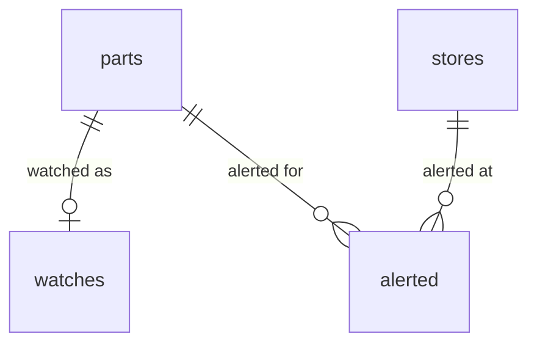
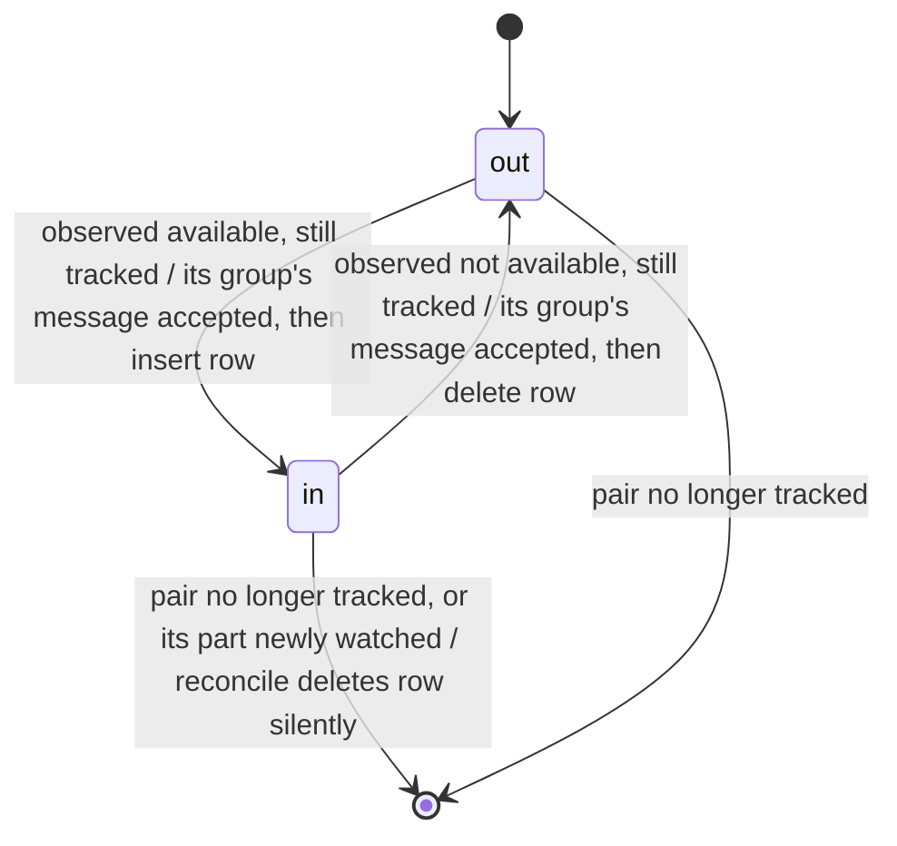
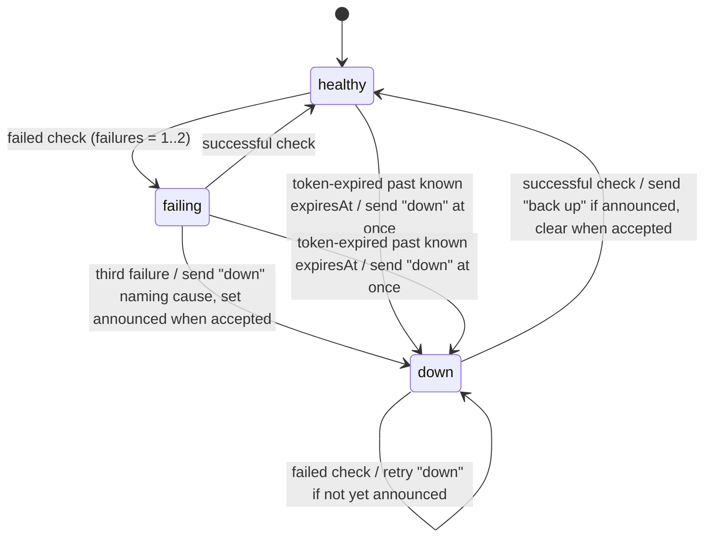
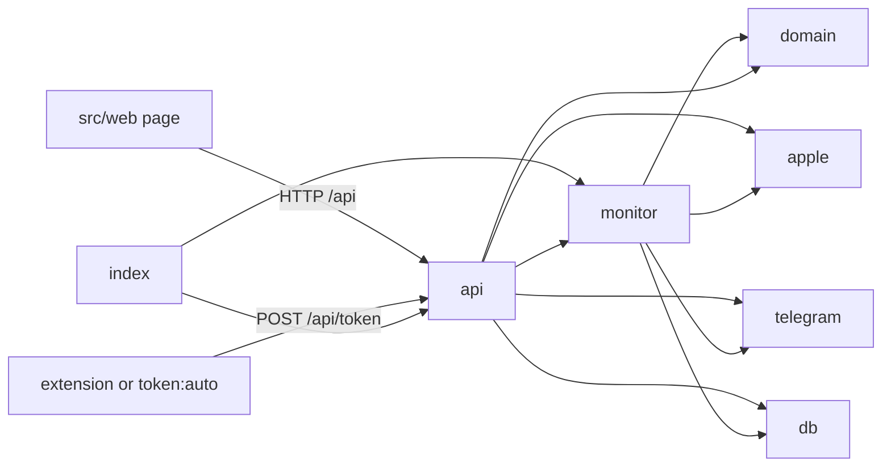
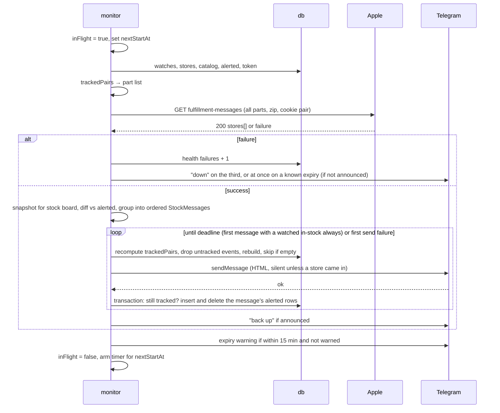

# Design: Apple Store pickup stock monitor

- Feature: pickup-watch
- Spec: docs/features/2026-10-22-pickup-watch/spec.md

## Impact

The repository holds no source code, configuration or tests yet, so no explorers ran; every row below is a document or an outside service the new code must respect.

### Impact map

| Area | What | Evidence | Why it matters |
|---|---|---|---|
| Doc | Spec scope | `docs/features/2026-10-22-pickup-watch/spec.md:20-32` | Every module the design adds must trace to one of these lines: catalog, watches, location, other colors, poller, token, stock state, alerts, health, UI, network exposure. |
| Doc | Spec out-of-scope list | `docs/features/2026-10-22-pickup-watch/spec.md:35-43` | Bounds the build: no login, deploy, multi-zip, non-US, model-level watches, checkout automation, autocomplete or sleep handling. |
| Doc | Spec acceptance criteria | `docs/features/2026-10-22-pickup-watch/spec.md:46-64` | Each test seam checks one of these lines; criterion 46 names the "iPhone 18 Pro" page, which also carries the 18 Pro Max. |
| Doc | Spec Facts | `docs/features/2026-10-22-pickup-watch/spec.md:67-77` | Deadline, single user, US only, always-on Mac, stack preference, shadcn/ui and local-first are the constraints the design rests on. |
| Doc | Spec decision log | `docs/features/2026-10-22-pickup-watch/spec.md:89-108` | Settled input: one request per cycle with other colors in it, edge-triggered alerts, Telegram, token source order, localhost default; the stack is left to this stage. |
| Doc | Persisted last state per (part, store) | `docs/features/2026-10-22-pickup-watch/spec.md:26`, `docs/features/2026-10-22-pickup-watch/spec.md:54` | The last known state must survive a restart so an unchanged pair never re-alerts. |
| Doc | Network exposure and secrets | `docs/features/2026-10-22-pickup-watch/spec.md:32`, `docs/features/2026-10-22-pickup-watch/spec.md:62-63` | The server binds to localhost by default, opts into the LAN, and no response may carry the bot token or Apple cookies. |
| External service | Apple `fulfillment-messages` request and response | `docs/features/2026-10-22-pickup-watch/apple-api-notes.md:9`, `docs/features/2026-10-22-pickup-watch/apple-api-notes.md:21-26` | The poller builds `parts.N` and `location`, and parses `stores[].partsAvailability[part].pickupDisplay` and `pickupSearchQuote` into stock state and Today/Tomorrow. |
| External service | Apple token pair with a 2 h hard expiry | `docs/features/2026-10-22-pickup-watch/apple-api-notes.md:16-20` | Every check sends `dssid2` + `shld_bt_ck` with a browser User-Agent; a 541 HTML reply means the token is rejected, and any unattended source must refresh inside 2 h. |
| External service | Apple `pickup-message-recommendations` | `docs/features/2026-10-22-pickup-watch/apple-api-notes.md:10` | Returns the 12 nearest stores with no token, so a zip can list stores before any token exists. |
| External service | Apple buy pages | `docs/features/2026-10-22-pickup-watch/apple-api-notes.md:12`, `docs/features/2026-10-22-pickup-watch/apple-api-notes.md:29-35` | The catalog keeps the unlocked `LL/A` phone variants (32 + 8), drops `S…` parts, groups other colors by `familyType` + `dimensionCapacity`, and builds buy links from `seoUrlToken`. |
| External service | Buy-page link format | `docs/features/2026-10-22-pickup-watch/apple-api-notes.md:27` | The alert button targets `/shop/buy-iphone/<page>/<seoUrlToken>`; whether a zip parameter is honoured is untested. |
| External service | Untested Apple behaviour | `docs/features/2026-10-22-pickup-watch/apple-api-notes.md:37-42` | Automated token, zip in the link and the 60 s block rate have to be checked in the spike or carried as risks. |
| External service | Telegram Bot API | `docs/features/2026-10-22-pickup-watch/spec.md:27-30`, `docs/features/2026-10-22-pickup-watch/spec.md:59`, `docs/features/2026-10-22-pickup-watch/spec.md:96-97` | Outbound `sendMessage` with an inline URL button for stock, health and test messages; the bot token and chat id are new secrets no response may return. |

#### Checked, not touched
- .git
- docs/features/2026-10-22-pickup-watch/trial-1
- docs/features/2026-10-22-pickup-watch/trial-2

## Constraints

- **Deadline 2026-11-01**, 9 days from this design (2026-10-23). The token spike is the existential risk and goes first (see Facts).
- **Technology preference** (spec Facts, a preference, not a decision): TypeScript, Node, Hono + Vite + React, SQLite in one process, UI in shadcn/ui. This design adopts it (decision 1).
- **Runtime on the Mac:** Node 22.17.0 and npm 10.9.2 installed (checked 2026-10-23); Brave 1.97.56 on Chromium 155, which ignores `--remote-debugging-port` on the default profile (Chromium 136+).
- **Apple is undocumented and bot-protected.** `fulfillment-messages` needs a `dssid2` + `shld_bt_ck` pair from one browser session, which expires 2 h after issue; a rejected call returns HTTP 541 with an HTML body. Catalog and store lookups need no token.
- **Apple endpoints checked 2026-10-23 without a token:**
  - `GET /shop/product-locator-meta?family=iphone18pro` returns JSON at `body.productLocatorOverlayData.productLocatorMeta.products[]` with `partNumber`, `carrierModel`, `productTitle`, `dimensionCapacity`, `dimensionColor`, `productLink`; 32 `UNLOCKED/US` entries (16 iPhone 18 Pro, 16 iPhone 18 Pro Max). `family=iphoneduo` returns 8. The other carriers' entries repeat the same part numbers. `family=iphone18promax` returns the same list as `iphone18pro`.
  - `GET /shop/pickup-message-recommendations?…&location=<zip>&product=<part>` returns 12 stores at `body.PickupMessage.stores[]` (capital P) with `storeNumber`, `storeName`, `city`, `state`, `storedistance` (miles, a number).
  - Both `…/6.3-inch-display-512gb-silver` and `…-unlocked` buy links return 200; whether `?location=` is honoured cannot be seen without a browser.
- **Apple checked 2026-10-23 for changes 1–5:**
  - `fulfillment-messages` answers at most 20 parts per request (spike parts-cap: every store returned 20 of 40, plan.md Escalations).
  - `product-locator-meta` gives one `productLink` per part for every carrier, with no carrier in it (`…/6.9-inch-display-256gb-black`). The buy page's own data names each configuration with a carrier suffix in `seoUrlToken`: `…-256gb-black-att`, `-t-mobile`, `-verizon`, `-unlocked`. The owner saw the suffix-less link open with only model and storage selected (user, 2026-10-23).
  - The buy page's URL-parameter schema lists `igt` (`ignoreTradeIn`, Boolean) and trade-in keys (`tt`, `pid`, `tdc`, `tia`), and no key for a store, zip or location. Whether the page honours `igt` on load needs a browser.
- **Older open-source monitors**, read with `gh` on 2026-10-23:
  - `fjwillemsen/Apple-Store-Stock-Notifier` (`store_checker.py`) and `worthbak/inventory-checker-app` (`FulfillmentModel.swift`, `PartAvailability.swift`) both used the `fulfillment-messages` route without any token, and the first used `product-locator-meta` for its catalog;
  - the second saw a third `pickupDisplay` value, `ineligible`;
  - the token requirement is newer than both.
- **Telegram Bot API:** outbound HTTPS only; about one message per second per chat before HTTP 429 with `retry_after`; the bot token sits in every request URL.
- **No project conventions yet:** no `CLAUDE.md`, `.claude/rules/` or `.fbs/context.md`.

## Options considered

**Data shape of the alert state** (the core of the change):

- **A. Alerted-set table.** One row per (part, store) whose in-stock alert was delivered and whose out-of-stock alert has not been. No row means "not alerted as in stock". Each check diffs the observations against this set. A check observation snapshot lives in memory for the grid.
  - Structure: one table, one pure diff function.
  - Cost: smallest to build; restart-safe because the set is what the user was last told.
  - For the user: exactly one message per change, including after a restart; a failed send retries next cycle because nothing was committed.
- **B. Observation log.** Store every check's observations and derive transitions by comparing the latest two snapshots.
  - Structure: an append-only table, a pruning job, a "last two snapshots" query.
  - Cost: more code and storage, plus a pruning job; a failed send has no natural retry, because the next snapshot pair no longer shows the change.
  - For the user: nothing extra; no criterion needs history.

**Process structure:**

- **A. One Node process.** Hono serves the API and the built page, and runs the scheduler in the same process. SQLite is a local file.
- **B. Web server plus a separate worker.** Two processes sharing SQLite, or Next.js for the page with a worker.
  - Adds a second process and cross-process coordination, and gains nothing for one user and one loop.

**Catalog source:**

- **A. `product-locator-meta` JSON.** Two token-free requests, clean fields, buy links included.
- **B. Scrape the buy pages' embedded JSON.** Regex over HTML, carrier duplicates, names from a separate list.

**Recommendation:** A for all three. It is the smallest shape that meets every acceptance criterion: one process, one alerted-set table, and a JSON catalog. Alerting through Telegram, the token-source order and one request per cycle are settled by the spec, so no option competes there.

## Decisions

1. **Stack:** Node 22 + TypeScript run by `tsx`, Hono on `@hono/node-server`, `better-sqlite3`, zod at every boundary, Vite + React + Tailwind + shadcn/ui, vitest. Telegram and Apple are called with plain `fetch`, with no SDK. Alternatives: Next.js, which needs a separate worker, and NestJS, which adds layers. `node:sqlite` is still experimental in Node 22. Why: one long-running loop for one user, and the owner's recorded preference.
2. **Alert state is the alerted set** (option A). A missing row means "not alerted as in stock", so stock already present when a watch is added, a store is re-enabled or the app first starts alerts on the next check (user, 2026-10-23).
3. **Pickup state is `in(label) | out`.** `pickupDisplay: "available"` is `in`; every other value (`unavailable`, `default`, `ineligible`, anything new) is `out`. The label is "Today" or "Tomorrow" when the `pickupSearchQuote` contains that word, otherwise the quote itself. A label change while in stock (Tomorrow → Today) sends nothing and only updates the stock board, because the spec's state is in or not in (spec.md:28, 62).
4. **The tracked set is one pure function**, `trackedPairs(watches, catalog, stores)`:
   - each watch's part × each enabled store, with role `watched`;
   - when the watch's other-colors switch is on, each same-model, same-capacity, different-color part × each enabled store, with role `other` and the watched colors it relates to;
   - a part that is itself watched is never also `other`;
   - a sibling of two watches is one `other` pair listing both watched colors.

   The check's part list, the diff and the pruning of the alerted set all use this one function.
5. **Only `monitor.ts` writes `alerted`.**
   - Turning off a store or watch, flipping the other-colors switch, or saving a zip prunes the alerted set silently: no out-of-stock message is sent for a pair the user stopped tracking.
   - Every such API mutation calls `monitor.reconcile()`, which recomputes `trackedPairs` and calls `db.pruneAlerted(tracked)`.
   - Creating a watch also deletes the alerted rows of its part, so the next check alerts it with the watched role even if it was alerted before as another color.
6. **Send pass, one message per model + storage:** the check's events are grouped by `modelName + capacity` (the sibling key of decision 4) by a pure `stockMessages(events, tracked, observations, alerted, catalog, stores)`. Each group with at least one event becomes one `StockMessage` (data shapes):
   - `colors`: every tracked pair of the group observed `in` this check, by color, watched colors first and then catalog order, stores by distance, each with its label and `isNew` (an `in` event this check);
   - `gone`: the group's `out` events, as color and store name;
   - `sound`: true when the group has at least one `in` event;
   - `commit`: the pairs to insert (its `in` events) and delete (its `out` events).

   A tracked pair missing from a 200 response keeps its alerted state (decision 8) and is neither listed nor reported gone. Messages go in priority order:
   1. groups with a watched in-stock event;
   2. groups with only other-color in-stock events;
   3. groups with only out-of-stock events.

   Ties keep catalog order.

   - Messages go one at a time, about 1.1 s apart, sent with `disable_notification: !sound`.
   - Before each send, the pass recomputes `trackedPairs` from the current db, drops the group's events whose pair is no longer tracked and rebuilds the message; a group left with no event is skipped.
   - After Telegram accepts, all of the message's inserts and deletes run in one synchronous better-sqlite3 transaction together with that membership check.
   - Any failure stops the pass, and the uncommitted groups come back, rebuilt, in the next diff. A 429 waits `retry_after` once if that fits before the deadline.
   - The pass ends 5 s before the next check is due. The first message with a watched in-stock event is always attempted whatever the deadline, and the next start waits until that send finishes.

   Why: one notification per restock of a model + storage, the latest message is always the whole picture (spec.md:28-30), a misconfigured bot must not mark stock as alerted, and a mutation made during a pass must not be undone by a stale diff. The alerted set keeps its meaning, so nothing migrates. Principle: principle-model-the-domain
7. **Scheduler:** single-flight, with an `inFlight` flag in `monitor.ts`.
   - When a check starts, the next start is set to `now + interval × U(0.75, 1.25)`; the end of the cycle is the only place that arms the timer, which waits for the rest.
   - A start that finds `inFlight` set returns at once.
   - The interval is 30–3600 s, default 60. Changing it while no cycle is in flight clears the pending timer and reschedules from now; while a cycle is in flight, it only updates `nextStartAt`.
   - Timeouts: 20 s for Apple, 10 s for Telegram.

   Why: start-to-start spacing stays 45–75 s at the default (spec.md:48), the change applies without a restart (spec.md:51), and there is never a second timer chain.
8. **Check outcome classification** in one place, `apple.ts`, by status first:
   - `fetch` threw or timed out → `network`;
   - HTTP 541, 401 or 403 → `token-expired` when the stored `expiresAt` has passed, else `token-rejected`;
   - 5xx (HTML body or not), any other status, a non-JSON body, a schema failure, no enabled store in the response, or a watched part missing from every store → `unexpected`.

   An enabled store missing from a 200 response keeps its pairs' state, and the grid shows it as "not checked". An other-color part missing from every store keeps its state. When no token, zip or tracked pair exists, the check is skipped and health is untouched.
9. **Health is persisted:** `failures` and `downAnnounced` live in `settings`.
   - The third consecutive failure sends one "monitoring is down" message naming the cause, and sets `downAnnounced` only once Telegram accepts it; a failed send retries on the next failure. A known token expiry skips the count (decision 21).
   - A success clears `failures`. When `downAnnounced` is set, it sends one "back up" message and clears the flag once accepted.
   - Why: exactly one down and one up, even across a restart or a lost message (spec.md:56).
10. **Catalog from `product-locator-meta`** (option A), for families `iphone18pro` and `iphoneduo`, keeping `UNLOCKED/US` entries.
    - Fetched once at startup, as an upsert by part that never deletes, so watches keep a valid row. While the `parts` table is empty, each check cycle retries it.
    - Model name, capacity and color name come from splitting `productTitle` at the capacity token, after normalising non-breaking spaces. Siblings share `modelName + capacity`.
    - The buy link is `productLink` with `-unlocked` appended to its last path segment (the buy page's own `seoUrlToken` for the unlocked configuration, Constraints), stored in `parts.buy_url`; the upsert rewrites it at the next startup. One part number covers every carrier, so only the link carries Unlocked. The zod schema requires `productLink` to be an `https:` URL on `www.apple.com` under `/shop/buy-iphone/`, with no query or fragment, and drops any entry that fails.
    - No Trade-in rides as `?igt=true` only if the implementation's hand check in Brave shows the page honours it; otherwise the link has no query. The result goes into `apple-api-notes.md`.
    - Store and zip are not in the link: the buy page's parameter schema has no key for either (Constraints). Every store link in a message opens the same configuration page, and the store is picked there (spec.md:31).
    - Telegram formatting is decision 25.

    This replaces the spec's "read from Apple's buy pages" with the JSON behind the same pages' store locator, keeping the same 40 configurations (spec.md:46).
11. **Stores come from `pickup-message-recommendations`**, using any catalog part, because it needs no token.
    - A zip save validates `^\d{5}$` and the response before writing.
    - It inserts new stores as enabled, keeps the toggle of stores still listed and deletes stores no longer listed, then calls `monitor.reconcile()`.
    - A failed lookup changes nothing.
12. **Token:**
    - Storage: one pair in `settings` (`dssid2`, `shld_bt_ck`, User-Agent, `expiresAt` parsed from the `shld_bt_ck` timestamp).
    - Writes: `POST /api/token` takes either a pasted cURL ("Copy as cURL" from Brave, cookie in `-b` or `-H 'cookie: …'`, User-Agent from `-H` or `-A`) or `{dssid2, shld_bt_ck, userAgent}` from the extension or `token:auto`.
    - Every pair is rejected when a cookie is missing, `shld_bt_ck` is malformed, it has expired, or its timestamp is more than 2 h + 5 min ahead of now.
    - An extension or `token:auto` post is stored only when its `shld_bt_ck` timestamp is strictly newer than the stored one. An equal timestamp gets a no-op 200.
    - A cURL pasted from the page (loopback) replaces the stored pair whatever its timestamp, so the owner can always recover by hand.
    - Apple's `Set-Cookie` replies are ignored; the spike measures whether adopting them helps.
    - Status for the strip: `missing | untested | working | rejected | expired`, plus the time left.
13. **Token source order** follows the spec (spec.md:25, 102), with one change: the CDP variant uses a dedicated, normally launched Brave profile (`--user-data-dir` of its own). Brave on Chromium 155 ignores remote debugging on the default profile (user, 2026-10-23). An automated source that passes the spike becomes `scripts/token-auto.ts`, run as `npm run token:auto`: a separate process that posts to `POST /api/token` before each expiry. Otherwise the MV3 extension does it.
14. **Extension, built only when the spike says so** (MV3, loaded unpacked in the daily Brave profile):
    - its ID is pinned with a `key` in `manifest.json`;
    - permissions: `cookies` and `alarms`; hosts `https://www.apple.com/*` and `http://127.0.0.1/*`;
    - after `chrome.cookies.onChanged` for `dssid2` or `shld_bt_ck` on `apple.com`, it waits 2 s after the last such event, then reads both cookies and posts them with `navigator.userAgent`;
    - a 30 min alarm reposts the pair, and when it expires within 40 min, opens `https://www.apple.com/shop/buy-iphone/iphone-18-pro` in an inactive tab and closes it after load, so Apple issues a fresh pair.
15. **Telegram credentials live in `.env`** (`TELEGRAM_BOT_TOKEN`, `TELEGRAM_CHAT_ID`), loaded with `process.loadEnvFile`. No route reads or writes them. Logs carry only the HTTP status and Telegram's `description`, never a URL. Why: one user, and no extra path that handles a secret. Principle: principle-smallest-change
16. **Network exposure:**
    - The server binds `127.0.0.1`, or `0.0.0.0` when `lanEnabled` was set at boot; the Wi-Fi toggle saves the setting and the strip says "restart to apply".
    - Every request must carry a `Host` on an allowlist: `localhost`, `127.0.0.1`, `[::1]`, plus, when LAN is on, the Mac's current IPv4 addresses and `<hostname>.local`. The addresses come from `os.networkInterfaces()`, read per request and cached for 5 s.
    - No LAN key: while Wi-Fi access is on, any device on the network can read the state and change watches, stores, zip and interval (user, 2026-10-23).
    - Every mutation must carry `Content-Type: application/json`, and an `Origin` that is absent, the page's own origin, or exactly the pinned `chrome-extension://<id>`.
    - No route sends CORS headers.
    - `POST /api/token` and `PUT /api/lan` require a loopback socket address.
    - Why: there is no login (spec.md:106), a website or another extension in the owner's browser can reach localhost, and DNS rebinding can forge `Host`. The owner accepted open access for devices on the Wi-Fi over a LAN key or read-only access (user, 2026-10-23).
17. **Responses are built from explicit DTOs.**
    - The token appears only as `{status, expiresAt}`.
    - Telegram appears only as `{configured, lastError}`, where `lastError` is `{kind: 'network' | 'timeout' | 'http', status?, description?}` and `description` comes only from Telegram's JSON `description` field, never from an error message.
    - Errors never echo the request body.

    Why: spec.md:63.
18. **UI:** four views in one page, polling `GET /api/state` every 5 s as today. The view lives in `location.hash` (`#/stock`, `#/watches`, `#/stores`, `#/settings`; anything else is `#/stock`), read on load and on `hashchange`, so refresh and back work with no router library.
    - Shell: at `md` (768 px) and wider, a fixed sidebar with the four views plus health and token status chips; below `md`, a top bar with the chips and a fixed bottom tab bar with four icon-and-label tabs. The active view is marked, and only that view renders.
    - **Stock board** (home): last successful check and health at the top, then one block per model + storage of the tracked parts, one row per color × enabled store with its Today / Tomorrow / Unavailable / Not checked badge and distance, in-stock rows first, "Other color" rows marked. In-stock store names link to the buy URL.
    - **Watches:** the Model → Storage → Color picker, "N / 20 parts tracked", and one compact row per watch with its other-colors switch and remove; the per-store badges move to the stock board.
    - **Stores:** zip form and store switches with distance.
    - **Settings:** Telegram status and test, token status and time left with the paste-cURL dialog, interval, Wi-Fi toggle with the LAN URL.

    Why: the owner uses the Mac and the phone equally and checks stock most (spec.md:35, 69-71), and a hash keeps the one-process static serving unchanged. Principle: principle-smallest-change
19. **One command:** `npm start` runs `vite build` and then `tsx src/server/index.ts`, which serves `dist/` and `/api`. `npm run dev` runs Vite's dev server with `/api` proxied to `127.0.0.1`.
20. **Fixtures hold Apple response bodies only**, captured with `scripts/capture-fixtures.ts`, which writes bodies and never request headers. Why: requests carry the owner's cookies.
21. **Token expiry warning and known-expiry down:**
    - When the stored `expiresAt` is within 15 minutes and no newer pair has arrived, the monitor sends one Telegram warning naming the expiry time ("paste a fresh cURL or open apple.com in Brave"). A `token_warned` flag is set once Telegram accepts it and reset when a newer pair is stored.
    - When a check runs with now past `expiresAt` and fails as `token-expired`, health goes down at once with that cause, instead of after 3 failures; it still sends exactly one down message.

    Why: expiry is the likeliest way the alert path stops, and its time is known in advance.
22. **Process supervision:**
    - A launchd LaunchAgent (`KeepAlive` true, `RunAtLoad` true) runs the server, and the README shows how to install it.
    - `index.ts` handles `unhandledRejection` and `uncaughtException` by logging and exiting non-zero, so launchd restarts it.
    - At boot the monitor sends one "monitor started" Telegram message, so a restart is visible.

    Why: a dead process sends no down alert, and silence must not look like no stock (spec.md:101).
23. **Secrets at rest:** at boot, `index.ts` creates `data/` with mode 0700 and the db file with 0600. The README setup says to `chmod 600 .env`. Why: the db holds the Apple cookie pair and `.env` the bot token.
24. **Parts cap of 20:** `trackedParts(watches, catalog)` in `domain.ts` returns the distinct parts of the tracked set (watched plus other colors, decision 4), and the check's part list is built from it.
    - `POST /api/watches` and turning a watch's other-colors switch on compute the count the change would give. Above 20, the route writes nothing and answers 409 `{error: 'parts-cap', cap: 20, tracked, adding}`. The page shows "Adds <adding> parts; <tracked> / 20 tracked" and keeps the picker's selection.
    - `StateDto` carries `parts: {tracked, cap}` for the Watches view.
    - Removing a watch, turning the switch off and saving a zip never hit the cap.
    - Why: Apple answers at most 20 parts per request, the owner accepted 20 (spec.md:25, 55), and a refusal drops nothing the owner set up.
25. **Telegram messages are HTML** (`parse_mode: 'HTML'`), the owner's formatting preference (spec.md Facts), over MarkdownV2, which needs 18 characters escaped instead of 3.
    - `telegram.ts` builds every message. Each Apple- or db-supplied string (model, capacity, color, store name, pickup label, cause) goes through one `escapeHtml` (`&`, `<`, `>`, `"`). Every `href` is a `parts.buy_url` already checked by decision 10, escaped the same way. No other tags than `<b>` and `<a href>` are emitted.
    - Stock message: `<b>📱 iPhone 18 Pro Max 256GB</b>`, then per color `<b>Black</b>` (or `<b>Glacier</b> · Other color`), then `🟢 Today:` and `🟡 Tomorrow:` lines of store links with distance, `🆕` before a new store, `🔴 Gone: Black at Fifth Avenue, …` when stores went out, and `🔴 Sold out everywhere` when no color is left. No inline button.
    - Other messages: `🚨 <b>Monitoring is down</b>`, `✅ <b>Back up</b>`, `⏳ <b>Token expiring</b>`, `▶️ <b>Monitor started</b>`, `🧪 <b>Test message</b>`, each with the current text as the body.
    - The worst case (4 colors × 12 stores, the longest store names) stays under Telegram's 4096-character limit, and a test asserts it.
    - Why: spec.md:29, 34, 63, and Apple text must never be read as markup.

## Data shapes

```ts
// src/shared/types.ts — shared by server and page
type PartNumber = string            // "MJQ84LL/A", validated /^[A-Z0-9]{5}LL\/A$/
type StoreNumber = string           // "R250", validated /^R\d{3,4}$/

type CatalogPart = {
  part: PartNumber
  modelName: string                 // "iPhone 18 Pro Max"
  capacity: string                  // "256gb"
  colorName: string                 // "Black"
  title: string                     // "iPhone 18 Pro Max 256GB Black"
  buyUrl: string                    // productLink, https://www.apple.com/shop/buy-iphone/…
}

type Pickup = { kind: 'in'; label: string } | { kind: 'out' }   // label: "Today" | "Tomorrow" | Apple's quote

type TrackedPair =
  | { part: PartNumber; store: StoreNumber; role: 'watched' }
  | { part: PartNumber; store: StoreNumber; role: 'other'; relatedColors: string[] }

type Observation = { part: PartNumber; store: StoreNumber; pickup: Pickup }

type StockEvent = { kind: 'in' | 'out'; pair: TrackedPair; label?: string }

// One Telegram message per model + storage with events in a check (decision 6)
type StockMessage = {
  group: { modelName: string; capacity: string }
  sound: boolean                                  // at least one 'in' event
  colors: {                                       // in stock now; empty means sold out everywhere
    colorName: string
    role: 'watched' | 'other'
    buyUrl: string
    stores: { store: StoreNumber; name: string; distanceMi: number; label: string; isNew: boolean }[]
  }[]
  gone: { colorName: string; storeName: string }[]
  commit: { insert: TrackedPair[]; delete: TrackedPair[] }
}

type CheckOutcome =
  | { ok: true; observations: Observation[]; stores: { store: StoreNumber; name: string; distanceMi: number }[] }
  | { ok: false; cause: 'network' | 'token-expired' | 'token-rejected' | 'unexpected' }

type GridCell = { part: PartNumber; store: StoreNumber; badge: 'Today' | 'Tomorrow' | string | 'Unavailable' | 'Not checked' }

type TokenStatus = 'missing' | 'untested' | 'working' | 'rejected' | 'expired'

type TelegramError = { kind: 'network' | 'timeout' | 'http'; status?: number; description?: string }
```

SQLite (`data/pickup-watch.db`, created with `CREATE TABLE IF NOT EXISTS` at boot; `db.ts` opens it from a path argument, so tests pass `:memory:`):

| Table | Columns | Notes |
|---|---|---|
| `parts` | `part` PK, `model_name`, `capacity`, `color_name`, `title`, `buy_url`, `sort` | Upserted, never deleted; `buy_url` is the unlocked link (decision 10) |
| `stores` | `store_number` PK, `name`, `city`, `state`, `distance_mi`, `enabled` 0/1 | Replaced per zip, keeping toggles |
| `watches` | `part` PK → `parts`, `other_colors` 0/1 default 1, `created_at` | One watch per configuration |
| `alerted` | (`part`, `store_number`) PK | Pairs the user was last told are in stock; written only by `monitor.ts` |
| `settings` | `id` = 1, `zip`, `interval_sec` default 60, `lan_enabled` 0/1, `token_dssid2`, `token_shld`, `token_ua`, `token_expires_at`, `token_warned` 0/1, `health_failures`, `health_down_announced` 0/1, `health_cause` | One row |

In memory only: the last check's observations and store metadata (for the grid), `lastCheckAt`, `lastSuccessAt`, the token's last outcome since it was stored, and Telegram's last error.



Pair alert state (one per tracked pair; `in` means an `alerted` row exists):



Health (persisted in `settings`):



## Module boundaries

| Module | Owns | May call |
|---|---|---|
| `domain.ts` | Types' logic: `trackedPairs`, `trackedParts`, `diff`, `stockMessages` (grouping and order, replacing `orderEvents`), `nextHealth`, `jitterMs`, `pickupFrom` | Nothing (pure) |
| `apple.ts` | Every Apple URL, request and zod schema, including the unlocked buy link; outcome classification; cURL and `shld_bt_ck` parsing | `fetch` (or `/usr/bin/curl` if the spike forces it) |
| `telegram.ts` | HTML text for each `StockMessage` and every other message kind, `escapeHtml`; `send` with `parse_mode` and `disable_notification`; classified `TelegramError` | `fetch` |
| `db.ts` | Schema and every SQL statement as typed functions, including `pruneAlerted(tracked)`; opened from a path argument | `better-sqlite3` |
| `monitor.ts` | Built by `createMonitor({apple, telegram, db, now})`. Scheduler, check cycle, send pass, health, token warning, catalog fetch at startup and retry while empty, `reconcile()`, in-memory snapshot. The only writer of `alerted` | `domain` and the injected `apple`, `telegram`, `db` |
| `api.ts` | Hono routes, guards, DTOs. Never writes `alerted`; calls `monitor.reconcile()` after every watch, store, other-colors or zip mutation | `db`, `domain`, `apple` (zip lookup, token parsing), `telegram` (test), `monitor` (snapshot, reschedule, reconcile) |
| `index.ts` | Boot: env, file modes, db, monitor start, fatal handlers, bind host and port, static files | all of the above |
| `src/web` | The page | `/api` over HTTP only |

Tests build the monitor with plain-object fakes for `apple` and `telegram`, an in-memory `db` and a fake `now`, with no module mocking.



Check cycle:



## File map

```
package.json                 scripts: start, dev, test, capture, token:auto (if the spike picks it)
tsconfig.json                strict TS for server, page and tests
vite.config.ts               React + Tailwind; dev proxy /api → http://127.0.0.1:$PORT
components.json              shadcn/ui config
index.html                   Vite entry
.env.example                 TELEGRAM_BOT_TOKEN, TELEGRAM_CHAT_ID, PORT=4319
.gitignore                   node_modules, dist, data, .env, spike/out
README.md                    setup (bot, chat id, .env with chmod 600), npm start, LaunchAgent install, pasting a cURL, extension install, Wi-Fi access (open to the network) and the macOS firewall
launchd/
  com.pickup-watch.plist     LaunchAgent template: KeepAlive, RunAtLoad, runs npm start in the repo
src/
  shared/types.ts            DTOs and domain types shared by server and page
  server/
    index.ts                 boot: load .env, file modes, open db, start monitor, fatal handlers, bind host, serve dist and /api
    db.ts                    schema and typed queries, pruneAlerted
    domain.ts                pure logic: tracked set, diff, event order, health, jitter, pickup label
    apple.ts                 Apple requests, zod schemas, outcome classification, cURL and token parsing
    telegram.ts              HTML message formatting with escapeHtml, sendMessage with parse_mode and disable_notification, classified errors
    monitor.ts               createMonitor: scheduler, check cycle, send pass, health, token warning, catalog fetch, reconcile, snapshot
    api.ts                   Hono routes, Host/Origin/loopback guards, DTOs
  web/
    main.tsx                 React root
    App.tsx                  shell: hash view, sidebar (md+) or top bar and bottom tabs, status chips, 5 s state polling
    api.ts                   typed fetch helpers for /api
    StockBoard.tsx           home view: blocks per model + storage, color × store rows, in stock first
    Stores.tsx               zip form and store switches (was Location.tsx)
    Watches.tsx              picker, parts count, compact watch rows with other-colors switch and remove
    Settings.tsx             Telegram, token (paste dialog), interval, Wi-Fi with LAN URL (was SettingsStrip.tsx)
    logic.ts                 pure page logic, including the hash → view parser and the stock board's row order
    components/ui/           shadcn/ui generated components
test/
  fixtures/                  Apple response bodies only: locator-18pro.json, locator-duo.json, stores-10001.json, fulfillment-*.json, rejected-541.html, maintenance-503.html
  domain.test.ts             tracked set and parts count, diff, stock messages (grouping, order, new and gone), health, jitter, labels
  telegram.test.ts           HTML rendering of every message kind, escaping, silent flag, 4096-character worst case
  apple.test.ts              parsers on fixtures, classification, cURL and token rules, productLink check, fixture cookie guard
  monitor.test.ts            check cycle with fake Apple and Telegram over in-memory SQLite, scheduler with fake timers
  api.test.ts                routes, guards, no secrets in any response
scripts/                     kept with the app
  capture-fixtures.ts        saves Apple response bodies (never headers) into test/fixtures
  token-auto.ts              only if the spike picks an automated source: refreshes and posts the pair before expiry
spike/                       throwaway, not shipped
  token.ts                   Node-replay with a stock Telegram send, parts-cap, Playwright and dedicated-profile CDP variants
  RESULT.md                  the spike's written result and chosen token source
extension/                   only if the spike picks it
  manifest.json              MV3 with a pinned key, cookies + alarms, apple.com and 127.0.0.1 hosts
  background.js              debounced cookie change → POST /api/token; 30 min alarm with refresh tab
```

## Test seams

| Criterion | Where | What the test controls or fakes |
|---|---|---|
| spec.md:46 picker lists every configuration | `apple.test.ts`, `domain.test.ts` | Locator fixtures parse to 32 + 8 parts with model, storage and color; siblings group by model and capacity; an entry with an off-domain or `javascript:` `productLink` is dropped |
| spec.md:47 stores from zip, all on; off never alerts | `api.test.ts`, `domain.test.ts`, `monitor.test.ts` | Fake Apple stores fixture; `trackedPairs` excludes disabled stores; toggles survive a re-save of the zip; a store toggled off in the middle of a send pass gets no message and no row |
| spec.md:54 one request, 45–75 s apart | `monitor.test.ts` | Fake Apple counts calls and asserts every tracked part in one URL; fake timers over 100 cycles assert start gaps of 45–75 s; an interval change in the middle of a cycle still gives one Apple call per period |
| spec.md:55 at most 20 parts, refused with count | `domain.test.ts`, `api.test.ts` | `trackedParts` counts a sibling of two watches once; a watch or switch-on that gives 21 parts gets 409 with `tracked` and `adding` and writes nothing; exactly 20 passes; `StateDto.parts` matches |
| spec.md:56-57 other colors on by default, in the group message as "Other color", switch off stops | `domain.test.ts`, `telegram.test.ts`, `monitor.test.ts` | New watch has `other_colors = 1`; a sibling `in` lands in its group's message under its color with role `other` and renders "Other color"; switch off removes it and prunes rows; watching a color already alerted as other lists it as watched on the next message |
| spec.md:58 interval change without restart | `monitor.test.ts` | Fake timers; reschedule takes effect on the next start |
| spec.md:59-60, 62 grouped in / out messages, sound, no repeats, restart, day label | `domain.test.ts`, `monitor.test.ts` | Two colors coming in at 3 stores in one check send one message with both colors, `isNew` on the 3, sound on; a later 4th store sends one message listing all 4 with only the 4th new; stores only going out send one silent message with `gone` and the rest; the last going out says sold out; a failed send commits none of the message's rows and the next check resends it rebuilt; a new monitor over the same db sends nothing for unchanged pairs; Tomorrow → Today alone sends nothing; at the 30 s floor with a slow fake Apple, the first watched in-stock message is still sent |
| spec.md:61 buy links preselect what Apple's URL supports | `apple.test.ts`; manual | Locator fixture links end in `-unlocked` and keep the domain check; an entry with a query or fragment is dropped; by hand in Brave: the link opens with color and Unlocked selected, and `igt=true` is kept only if it selects No trade-in |
| spec.md:63 other messages styled | `telegram.test.ts` | Down, up, token expiring, started and test messages each start with their emoji and `<b>` heading |
| spec.md:64 `unavailable`, `default` not in stock | `domain.test.ts` | `pickupFrom` for each value plus `ineligible` and an unknown value |
| spec.md:65 one down after 3 failures, one back up | `monitor.test.ts`, `apple.test.ts` | Fake Apple fails with each cause; a 503 HTML fixture is `unexpected`, not a token cause; a 200 missing a watched part is `unexpected`; Telegram fails once on "down" and the retry still sends exactly one; restart between down and up; a known expiry goes down at once with one message |
| spec.md:66 token status and cURL paste | `apple.test.ts`, `api.test.ts` | Chrome "Copy as cURL" samples with fake cookies; rejects missing, malformed, expired and far-future pairs; extension posts need a strictly newer timestamp, a pasted cURL replaces any; loopback guard; only the pinned extension origin passes; the 15 min warning is sent once and reset by a newer pair |
| spec.md:67 spike within 1 day; extension keeps token valid | `spike/RESULT.md`; manual | Written result; with the extension, a 3 h run where the token status stays `working` |
| spec.md:68 test message | manual | Real bot and chat |
| spec.md:69 stock board with Today/Tomorrow/unavailable, in stock first, last check time | `api.test.ts`, `web-logic.test.ts` | `GET /api/state` DTO after a faked check; an enabled store absent from the response shows "Not checked"; the board's row order puts in-stock rows first |
| spec.md:70 four views, sidebar or bottom tabs, refresh and back | `web-logic.test.ts`; manual | The hash parser maps each hash and falls back to `#/stock`; by hand: sidebar at 1280 px, bottom tabs at 375 px, refresh and back keep the view |
| spec.md:71 375 px, no horizontal scroll | manual | Brave device toolbar at 375 px, every view |
| spec.md:72 localhost by default, Wi-Fi opt-in | `api.test.ts`; manual | Host allowlist and loopback guards in tests; phone on the same network after enabling and restarting |
| spec.md:73 no secrets in responses | `api.test.ts`, `apple.test.ts` | Seed fake token and env values; call every route, including errors, and assert none of them appears; a fake Telegram error whose message holds the full bot URL does not reach `/api/state`; with the curl fallback, the spawned argv holds no cookie value |
| spec.md:74 one command | manual | `npm start` on a clean clone |
| escaping (decision 25) | `telegram.test.ts` | A store name or label holding `<b>`, `&` and `"` renders literally; the message's only tags are `<b>` and `<a href>` |

Fixture guard: `apple.test.ts` fails if any fixture contains `dssid2=`, `shld_bt_ck=` or a `Set-Cookie` line.

## Risks

- **No automated token source works** (medium): the extension is the planned route. Until it exists, a pasted pair lasts at most 2 h; the owner gets a warning 15 min before expiry and a down alert at once when it passes (decision 21).
- **Node's `fetch` is rejected where curl and the browser were accepted** (unknown; TLS fingerprinting): spike step 1 replays the pair from Node with a curl control. If only curl passes, `apple.ts` calls `/usr/bin/curl` through `execFile`. The cookie and User-Agent headers go to curl on stdin with `--config -`, so only the URL is in argv. The execFile error object is never logged, only its mapped cause.
- **A tab opened by the extension does not get a fresh accepted pair** (unknown): spike step 5 checks it by hand. If not, the extension still forwards pairs from the owner's normal browsing, and the README says to keep an apple.com tab open.
- **Apple caps parts per request** (settled: 20): the cap of decision 24 keeps the request within it. If Apple lowers it, the truncation shows up as `unexpected` (decision 8).
- **The buy page ignores the `-unlocked` suffix or `igt`** (unknown until the hand check): the link still opens the configuration's page, as before; `igt` is dropped unless it works.
- **HTML formatting breaks a message** (low): a string that slips past `escapeHtml` makes Telegram answer 400 and the pass stops, so the group's rows stay uncommitted and the message retries each check without arriving. The escaping test covers every interpolated field, and the 400's `description` reaches `lastError` on the page.
- **Grouping delays a watched alert** (low): a group's message waits for nothing but its place in the order; groups with a watched in-stock event go first, as single events did.
- **Apple blocks the session or IP at a 60 s rate** (medium): health reports it within about 3 minutes, and the interval can be raised. A block may also refuse the owner's own checkout from that IP; the README says to check out from the phone on cellular.
- **No store or zip in the buy link** (settled): the page's parameter schema has no key for either, so every store link in a message opens the same page (decision 10).
- **Apple changes JSON shapes or routes** (low per week, high over months): zod failures become `unexpected` and reach the down alert; the stored catalog keeps the picker working.
- **First-start burst hits Telegram's limit** (medium): decision 6 paces, orders and bounds the send pass.
- **Wi-Fi access without login** (opt-in, accepted by the owner): while it is on, any device on the network can read the state and change watches, stores, zip and interval, and could silently switch off a watch. The token and the Wi-Fi switch stay Mac-only.
- **macOS firewall blocks incoming LAN connections to `node`** (medium on first opt-in): the README covers allowing it.
- **Duplicate stock message** (low): a Telegram timeout after delivery, or a crash between delivery and the commit, can send one duplicate in-stock or out-of-stock message.
- **Test messages share the alert budget** (low): with LAN on, any device can call the test route, and repeated test-message calls share the alert chat's Telegram rate budget and can delay an alert by one cycle.
- **Deleting the db re-alerts** (low): deleting `data/pickup-watch.db` re-alerts every pair currently in stock, and a schema change needs a hand-written ALTER until a migration step exists.
- **Apple's terms limit automated access** (unknown consequence): no Apple ID, one request a minute, personal use.

## Rollout

Single user on their own always-on Mac (spec.md, Facts), so there is no staged release, flag or migration: the owner fills `.env`, runs `npm start`, and installs the LaunchAgent from the README once the app is in daily use.

Order of work against the 2026-11-01 deadline (spec.md, Facts), riskiest piece first, with a live monitor running as soon as one exists:

1. **Day 1 token spike** (`spike/token.ts`, time-boxed to 1 day):
   1. replay a freshly pasted pair from Node `fetch` every 60 s until it expires, with one curl replay as a control; also try adopting `Set-Cookie`. While it runs, send a plain Telegram message when any part from an env var or constant list shows `available`; the list includes the owner's Duo configuration(s), and this runs before the Duo's pickup opening on 10.24;
   2. send one request with all 40 parts;
   3. run Playwright Chromium headful on the buy page, read the pair, and test it; refresh every 90 min for 2+ h;
   4. do the same through CDP into Brave launched normally with a dedicated `--user-data-dir`;
   5. by hand in the daily Brave: open the buy page in a new tab and check that `shld_bt_ck`'s timestamp moves forward and the new pair returns 200;
   6. write `spike/RESULT.md` with the chosen source.
2. Capture fixtures, then build `domain`, `apple`, `telegram`, `db` and `monitor` with their tests; run live on a pasted cURL with watches seeded by a script or an SQL insert, and keep it running from then on.
3. The token source the spike chose (`scripts/token-auto.ts` or the extension), with a 3 h unattended run.
4. `api` and the page, then the LaunchAgent.
5. Manual checks (375 px, phone over Wi-Fi, test message, `?location=` link), then a sustained live run toward the success measure.

The db file must survive upgrades: deleting it re-alerts every pair in stock.

Changes 1, 2, 4 and 5 (2026-10-23, `changes.md`) need no migration: the alerted set keeps its meaning, so pairs already alerted stay quiet until they change, and `parts.buy_url` is rewritten by the catalog upsert at the next start.

## Facts
- The alerts must be working by 2026-11-01 (spec.md)
- The monitor has a single user, the owner (spec.md)
- Only US Apple Stores are watched (spec.md)
- The Mac running the monitor is always on and does not sleep (spec.md)
- The user prefers TypeScript, React and Node, and agreed to Hono + Vite + React with SQLite in one process (spec.md)
- The user wants the UI built with shadcn/ui (spec.md)
- The app runs locally for now; a later deploy may target Railway (spec.md)
- The Apple token pair expires 2 h after issue and replaying it does not extend it (docs/features/2026-10-22-pickup-watch/apple-api-notes.md:19)
- Stock already present when a watch is added, a store is re-enabled or the app first starts alerts right away (user, 2026-10-23)
- The spike's CDP variant uses a dedicated, normally launched Brave profile (user, 2026-10-23)
- Apple's product locator lists 32 unlocked iPhone 18 Pro and Pro Max parts and 8 iPhone Duo parts without a token (https://www.apple.com/shop/product-locator-meta?family=iphone18pro)
- With Wi-Fi access on, any device on the network may read and change watches, stores, zip and interval, with no LAN key (user, 2026-10-23)
- The owner will watch at least one iPhone Duo configuration (user, 2026-10-23)

## Assumptions
None

## Open questions
None

## Gulag outcome
**Panel:** workflow fbs:panel. Seats: pessimist, security, lazy-boi, code-purist, staff-engineer; none missing.

- pessimist-1 (major): accepted, a check's diff is computed before a 20 s Apple call and the send loop, so a prune made mid-pass can be undone by a stale insert or contradicted by an out-of-stock send.
- pessimist-2 (major): accepted, an interval change mid-cycle had no pending timer to clear and could leave two timer chains.
- pessimist-3 (major): accepted, narrowed: a 200 missing a watched part is `unexpected` and a missing enabled store shows "not checked"; no extra health message.
- pessimist-4 (major): accepted, nothing restarted the process after a crash or reboot, and a dead process sends no down alert.
- pessimist-5 (major): accepted, a same-timestamp mixed pair could replace a working one and a valid pasted pair could not recover it.
- pessimist-6 (minor): rejected, a duplicate after a Telegram timeout is rare and harmless, and the next diff already retries; kept as a risk.
- pessimist-7 (minor): accepted, at the 30 s floor the send budget can be negative, skipping a watched alert cycle after cycle.
- pessimist-8 (minor): accepted, a part alerted as another color kept its row when watched, so the watched alert never came.
- pessimist-9 (minor): accepted, an Apple 5xx maintenance page would have been reported as a token problem.
- pessimist-10 (minor): accepted, the Host allowlist fixed at boot would lock the phone out after a network change.
- security-1 (major): accepted, with LAN on any device could change watches with no credential; the LAN key goes back to the owner as an open question.
- security-2 (major): accepted, a forged far-future pair could block every later write, and any extension origin was allowed.
- security-3 (minor): rejected, once LAN callers need a key only the owner can reach the test route; kept as a risk.
- security-4 (minor): accepted, the curl fallback would put cookies in argv and in execFile's error object.
- security-5 (minor): rejected, speculative: loopback-only route, fetch rejects CR/LF, no shell, and the parser keeps only cookie and User-Agent.
- security-6 (minor): accepted, an error message stored as `lastError` could carry the bot-token URL into `/api/state`.
- security-7 (minor): accepted, `productLink` went unchecked into an href and the alert button.
- security-8 (minor): accepted, the db and `.env` hold credentials and were created with default permissions.
- security-9 (minor): rejected, speculative: needs dev mode with an explicit `--host` and LAN on.
- lazy-boi-1 (minor): accepted, the lineup is fixed and a restart picks up new parts, so the refresh timer goes.
- lazy-boi-2 (minor): rejected, in-memory health would lose `downAnnounced` on restart and drop the required "back up" message.
- lazy-boi-3 (minor): rejected, mostly taste on tiny items; `sort` keeps Apple's order and the capture script enforces bodies-only.
- code-purist-1 (minor): accepted, `token:auto` had no file in the file map.
- code-purist-2 (minor): accepted, `alerted` had two writers; pruning now goes through `monitor.reconcile()`.
- code-purist-3 (minor): rejected, taste: two `api.ts` files in separate folders cause no problem.
- code-purist-4 (minor): accepted, the test seams needed an injection point for fakes.
- staff-engineer-1 (major): accepted, the token's expiry is known in advance, so a warning and an immediate down are cheap.
- staff-engineer-2 (minor): accepted, the spike can alert on stock during the build, and step 2 seeded watches from a page that did not exist yet.
- staff-engineer-3 (minor): rejected, no schema change is planned; kept as a risk.

The judge noted that no seat could open the two GitHub repos; the architect had read them with `gh` before the panel, as Constraints now says.

Changes applied:
- decisions 5 to 12, 14, 16 and 17 revised, and decisions 21 (token expiry), 22 (process supervision) and 23 (secrets at rest) added;
- `lan_key`, `token_warned`, `GridCell` and `TelegramError` added to the data shapes; the alert-state, health and check-cycle diagrams updated;
- module boundaries updated: `createMonitor` dependencies, `reconcile`, a single writer of `alerted`;
- file map updated: `launchd/`, `scripts/token-auto.ts`, the 503 fixture, the spike's Telegram send;
- test seams, risks and rollout updated;
- two open questions added.

Stale: after the review, the owner chose open Wi-Fi access over security-1's LAN key (user, 2026-10-23). The LAN key, its `lan_key` column, header and tests were removed, and the Wi-Fi risk is back to open access. The judge's reason for rejecting security-3 ("once security-1 gates LAN callers") no longer holds; the test-message risk line stays. The Duo answer added the owner's Duo parts to the spike's alert list. The owner declined a panel rerun for this change (user, 2026-10-23).

## Decision log
- 2026-10-23: Hono + Vite + React + shadcn/ui with `better-sqlite3` in one Node process, over Next.js with a worker, NestJS or `node:sqlite`. Why: one loop for one user, the owner's recorded preference, and `node:sqlite` is still experimental in Node 22. Principle: principle-smallest-change
- 2026-10-23: Store the alerted set per (part, store) and diff against it, over an observation log. Why: smallest shape that meets the restart criterion, and an uncommitted send retries for free. Principle: principle-smallest-change
- 2026-10-23: Pickup state is `in(label) | out`, with every value other than `available` as `out`, including `ineligible` and unknown ones. Why: one structure decides every message, and the spec counts every other value as not in stock. Principle: principle-model-the-domain
- 2026-10-23: A missing alerted row counts as not alerted, so stock that is already there alerts on the next check. Why: the owner wants to hear about stock already there (user, 2026-10-23).
- 2026-10-23: Tomorrow → Today on a pair already in stock sends no message. Why: the spec's state is in or not in, and the day is a label (spec.md:26-27).
- 2026-10-23: One pure `trackedPairs` defines the tracked set for the request, the diff, the send-time check and pruning, with watched parts never doubling as other colors. Why: four callers need the same rule. Principle: principle-model-the-domain
- 2026-10-23: Only `monitor.ts` writes `alerted`; API mutations call `monitor.reconcile()`, which prunes untracked rows silently and clears a newly watched part's rows. Why: one writer cannot drift, a stopped pair needs no out-of-stock message, and a color first alerted as "other" must still get its watched alert (gulag: code-purist-2, pessimist-8).
- 2026-10-23: Ordered, paced send pass that re-checks tracking before each send and inside the commit transaction, stops on the first failure, ends 5 s before the next check and always attempts the first watched in-stock event. Why: watched alerts must land within one cycle, spacing must hold, a failed send must not mark stock as alerted, and a mid-pass mutation must not be undone (gulag: pessimist-1, pessimist-7).
- 2026-10-23: Single-flight scheduler with an `inFlight` flag, timed start to start, interval 30–3600 s with ±25 % jitter; 20 s Apple and 10 s Telegram timeouts. Why: keeps 45–75 s at the default, applies changes without a restart, and never runs two timer chains (gulag: pessimist-2).
- 2026-10-23: Classify Apple outcomes by status first; 5xx, non-JSON and a 200 missing a watched part are `unexpected`; a missing enabled store shows "not checked". Why: a maintenance page is not a token problem, and a silent gap must not look like no stock (gulag: pessimist-3, pessimist-9).
- 2026-10-23: Health failures and `downAnnounced` persisted, down and up messages gated on delivery. Why: exactly one of each, even across a restart or a lost send.
- 2026-10-23: Catalog from `product-locator-meta` JSON, fetched at startup and retried only while empty, with `productLink` checked against `https://www.apple.com/shop/buy-iphone/`; Telegram text sent without `parse_mode`. Why: the same 40 configurations from a token-free JSON route, no HTML regex or refresh timer to maintain, and no unchecked link or markup reaches the owner (gulag: lazy-boi-1, security-7). Principle: principle-smallest-change
- 2026-10-23: Store list from `pickup-message-recommendations`, validated before any write, keeping toggles. Why: needs no token, a failed lookup changes nothing, and re-saving a zip must not re-enable excluded stores.
- 2026-10-23: All token sources go through the loopback-only `POST /api/token`. It rejects partial, malformed, expired or far-future pairs, takes automated posts only when strictly newer, and lets a pasted cURL replace any pair. Why: the pair expires 2 h after issue, a mixed or forged pair must not wedge the monitor, and the owner must always be able to recover by hand (gulag: pessimist-5, security-2).
- 2026-10-23: The CDP spike variant uses a dedicated, normally launched Brave profile, not the daily one. Why: Brave on Chromium 155 ignores remote debugging on the default profile, and the owner chose it (user, 2026-10-23).
- 2026-10-23: The extension has a pinned ID, debounces cookie changes by 2 s, and is the only extension origin the server accepts. Why: Apple rotates `dssid2` separately from `shld_bt_ck`, and any other extension could reach localhost (gulag: pessimist-5, security-2).
- 2026-10-23: Telegram credentials in `.env`, logs redacted to status and description, `lastError` a classified type. Why: one user, no route that handles the secret, and the bot token sits in every request URL (gulag: security-6). Principle: principle-smallest-change
- 2026-10-23: Bind 127.0.0.1 by default, Wi-Fi toggle applies on restart, Host allowlist from interfaces read per request, JSON-only mutations with an exact Origin rule, no CORS, loopback-only token and Wi-Fi routes. Why: no login in v1 (spec.md:106), and websites, other extensions and DNS rebinding can reach localhost (gulag: security-2, pessimist-10). Principle: principle-smallest-change
- 2026-10-23: No LAN key: with Wi-Fi access on, any device on the network may read and change watches, stores, zip and interval, over a LAN key or read-only access for other devices. Why: the owner's choice, consistent with the spec's no-login v1; the token and the Wi-Fi switch stay Mac-only (user, 2026-10-23; gulag: security-1).
- 2026-10-23: The spike's stock alert lists the owner's Duo configuration(s) and runs before the Duo's pickup opening on 10.24. Why: the owner will watch a Duo, and that opening is the first real event the build can catch (user, 2026-10-23).
- 2026-10-23: Warn 15 min before the token expires, and go down at once on a known expiry. Why: expiry is the likeliest way alerts stop, and its time is known (gulag: staff-engineer-1).
- 2026-10-23: launchd LaunchAgent with exit-on-fatal handlers and a "monitor started" message. Why: a dead process sends no down alert (gulag: pessimist-4).
- 2026-10-23: `data/` at 0700, the db at 0600, `.env` at 0600 per the README. Why: they hold the Apple cookie pair and the bot token (gulag: security-8).
- 2026-10-23: The curl fallback, if needed, passes headers on stdin and never logs the execFile error. Why: argv and `err.cmd` would expose the cookie pair (gulag: security-4).
- 2026-10-23: One-column card layout polling `GET /api/state` every 5 s, over a table or websockets. Why: 12 stores cannot fit at 375 px, and checks run once a minute. Principle: principle-smallest-change
- 2026-10-23: Seven flat server files with one owner role each, with `createMonitor` taking its dependencies and `db.ts` opened from a path. Why: one caller per function, a short read path, and fakes without module mocking (gulag: code-purist-4). Principle: principle-smallest-change
- 2026-10-23: Fixtures hold Apple response bodies only, guarded by a test. Why: requests carry the owner's apple.com cookies.
- 2026-10-23: Rollout builds the token spike first, with a Telegram send on stock, then the core running live on a pasted cURL with watches seeded by script, then the token source, then the API, page and LaunchAgent. Why: the token is the existential risk, and an early live monitor can catch a stock event during the build (gulag: staff-engineer-2).
- 2026-10-23: Rejected pessimist-6: a Telegram timeout after delivery can send a message twice. Why: not worth it at this stage; a duplicate after a Telegram timeout is rare and harmless, and the suggested retry rule is already how the next diff behaves, so only a Risks note is warranted.
- 2026-10-23: Rejected security-3: unlimited test-message calls can delay an alert. Why: not worth it at this stage; once security-1 gates LAN callers, only the owner can reach the test route, and a cooldown plus queueing adds mechanism for a self-inflicted, rare delay.
- 2026-10-23: Rejected security-5: token fields go into headers and curl without charset or length limits. Why: speculative; the token route is loopback-only, Node fetch rejects CR/LF in header values, execFile runs no shell, and the parser takes only the cookie and the User-Agent.
- 2026-10-23: Rejected security-9: dev mode's proxy makes every request loopback. Why: speculative; it needs the owner to run dev mode with an explicit `--host` and LAN on, because with LAN off the Host allowlist already rejects a LAN IP Host.
- 2026-10-23: Rejected lazy-boi-2: keep health in memory. Why: with in-memory health, a restart after a down alert loses `downAnnounced`, so the "back up" message spec.md:56 requires never arrives, and restarts become expected once the supervisor is added. Principle: principle-smallest-change
- 2026-10-23: Rejected lazy-boi-3: drop the capture script, three columns and most diagrams. Why: mostly taste on tiny items; diagrams are documentation, not code, `sort` keeps Apple's order, which capacity strings like "1tb" vs "256gb" can't reproduce in SQL, and the capture script is a few lines that enforce the bodies-only rule. Principle: principle-smallest-change
- 2026-10-23: Rejected code-purist-3: rename one of the two `api.ts` files. Why: taste; two `api.ts` files in separate `server/` and `web/` folders cause no functional or ownership problem.
- 2026-10-23: Rejected staff-engineer-3: add a versioned migration runner. Why: not worth it at this stage; no schema change is planned, and a migration runner can wait for the first one, so only the risk that deleting the db re-alerts every in-stock pair needs recording.
- 2026-10-23: Amended: the send pass groups events into one `StockMessage` per model + storage, listing every in-stock store per color with new ones marked and gone ones named, silent unless a store came in, committing all its rows on acceptance. Why: change 1 (user, walkthrough 2026-10-23). Principle: principle-model-the-domain
- 2026-10-23: Amended: Telegram messages are HTML with one `escapeHtml` and only `<b>` and `<a href>`, over MarkdownV2; every message kind gets an emoji and bold heading. Why: change 1 (user, 2026-10-23); HTML needs 3 escapes instead of 18.
- 2026-10-23: Amended: buy links append `-unlocked` to `productLink`, add `igt=true` only if a hand check shows it works, and carry no store or zip. Why: change 2 (user, 2026-10-23); the buy page's `seoUrlToken` carries the carrier, and its parameter schema has no store or zip key.
- 2026-10-23: Amended: the page becomes four hash-routed views with a sidebar at md and wider and bottom tabs below, the stock board as home. Why: change 4 (user, 2026-10-23); no router library, and static serving stays as it is. Principle: principle-smallest-change
- 2026-10-23: Amended: at most 20 tracked parts, checked by `trackedParts` in the watch and other-colors routes with a 409 that writes nothing. Why: change 5 (user, 2026-10-23); Apple answers at most 20 parts per request.
