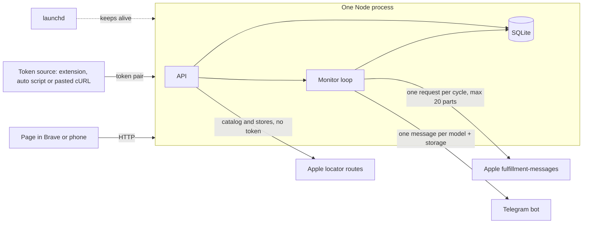
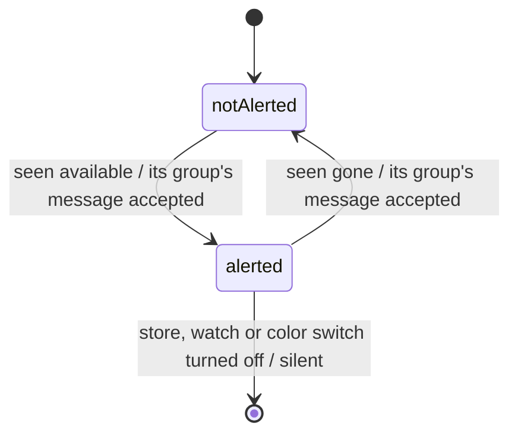

# Overview: Apple Store pickup stock monitor

- Feature: pickup-watch
- Source of truth: docs/features/2026-10-22-pickup-watch/design.md. This page summarises it (and the spec's problem and scope) for review, and adds nothing to them.

## What we're building
New iPhones sell out for in-store pickup, and stock appears at single Apple Stores without warning. A local monitor on the owner's Mac checks the exact configurations they watch, at most 20 parts, at the stores near one zip about once a minute. When stock comes or goes, it sends one Telegram message per model and storage: every in-stock store per color under Today and Tomorrow, new stores marked, and one buy button per color that opens Apple's page with the color and Unlocked already selected. Left out on purpose: login, deploying to Railway, several zips, non-US stores, model-level watches, automated checkout, and more than 20 parts.

## Architecture

One Node process serves the page and the API and runs the monitor loop. Each cycle, the monitor works out which (configuration, store) pairs are tracked. It asks Apple about all of them in one request, using the token pair a browser-side source keeps fresh, and compares the answer with what the owner was last told. It groups the changes by model and storage and sends one HTML message per group. The catalog and the store list come from Apple routes that need no token. launchd restarts the process if it dies.

## Stock board (redesign, change 9)
The home view now answers "where can I pick up my phone right now". A freshness line sits on top ("Checking every minute · last check 14 s ago"). Below it, one section per phone, phones with stock first: its finish-color dot, the stores that have it with Today or Tomorrow and distance, and one Buy button. The stores without stock collapse into one line, and phones with nothing nearby sit quietly at the end. When monitoring is down, a red banner explains the fix and the last known stock fades beneath it. Light, warm and restrained: green only for Today, amber only for Tomorrow, after the Apple Store app and Flighty. Mockup with every state: `mockups/stock-board.html`.

## Approach and why
We store only "which pairs the owner was told are in stock" and compare each check against it, all in one process with a JSON catalog. Messages are built per model and storage from that comparison, and a message's pairs are saved only once Telegram accepts it.
- Observation log instead of the alerted set: lost, because it needs history and pruning no criterion asks for, and failed sends have no natural retry.
- Separate worker process: lost, because a second process gains nothing for one user and one loop.
- Scraping buy-page HTML for the catalog: lost to Apple's token-free locator JSON, which has the same 40 configurations.
- One message per color, or one message edited in place: lost to one new message per model and storage, because you watch all 4 colors of one model, and Telegram edits make no sound.
- A link per store name: lost to one button per color, because Apple's buy URL can't carry a store, so every store link would open the same page.

## Data model

Watches, stores and the catalog are tables. Each watch is one exact configuration, with an "also other colors" switch. Health ("down" announced or not) and the token are kept in one settings row. Nothing migrates for the amendment: the alerted set keeps its meaning.

## Key decisions
- One message per model and storage whenever a store comes in or goes out, with the full current list. It makes a sound only when a store came in; stores only going out arrive silently.
- Tomorrow → Today on a store already in stock sends nothing, because those labels flip by themselves every day.
- The buy link adds `-unlocked`, which you checked selects color and Unlocked. No trade-in (`igt=true`) is kept only if a quick check shows it works. Store and zip can't go in Apple's URL.
- Messages are HTML: every Apple string is escaped, the only tag is bold, and links go only into buttons. Every message kind gets its own emoji.
- At most 20 tracked parts. A change that would go over is refused and writes nothing; a set already over 20 is shown in red, never trimmed silently.
- The page has four views (Stock board, Watches, Stores, Settings), a sidebar on the Mac and bottom tabs on the phone, with the view kept in the URL.
- A message counts as sent only once Telegram accepts it, so failures retry. A message Telegram refuses is skipped so it can't hold back the others, and groups with a watched color in stock go first.
- Stock already there when you add a watch or start the app alerts right away. You asked for this.
- The token is warned about 15 minutes before it expires, and "down" goes out at once when it does.
- With Wi-Fi access on, any device on the network can use the page, with no key. You chose this. The token and the Wi-Fi switch stay Mac-only.

## Risks
- No automated token source works. The extension is the planned fallback, and the 15-minute warning covers pasted tokens.
- Apple ignores `igt=true`. The link then just leaves trade-in for you to pick, as it does today.
- A message breaks Telegram's HTML. That message is skipped and retried, the others still go out, and the error shows on the page.
- Apple lowers its 20-part limit. A missing watched part shows as a health alert.
- Apple blocks the IP at one request a minute. Health reports it within about 3 minutes, and the interval can be raised.
- Apple changes its JSON. Validation turns this into a health alert, and the stored catalog keeps the picker working.

## Rollout
Local only, for one user on an always-on Mac. The amendment starts with the one-minute `igt=true` check in Brave, then the grouped messages and buy buttons, the 20-part cap, and the four-view page. Restart `npm start` to pick it up; the next start rewrites the buy links.

## Review
The first five-seat review raised 29 findings and the judge accepted 21. The amendment's review raised 22 and the judge accepted 14. The changes that mattered most:
- a refused message no longer blocks every other one;
- a store missing from one Apple response can't make a message say "sold out";
- a part list over 20 is cut with watched colors first and shown on the page;
- Apple labels other than Today and Tomorrow get their own line.

## Needs your call
- The panel flagged `curl.txt` at the repo root as a possible cookie leak. You said it holds no sensitive data, so nothing changes.
- The catalog comes from Apple's locator JSON instead of the buy-page HTML the spec names. It has the same 40 configurations.
