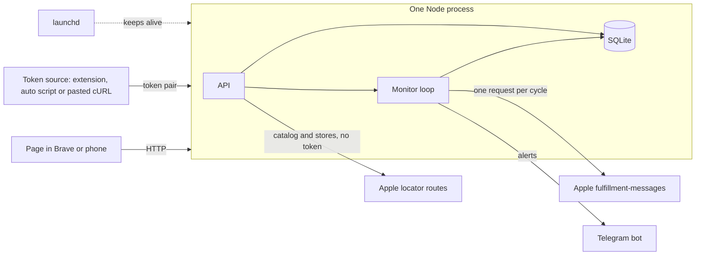
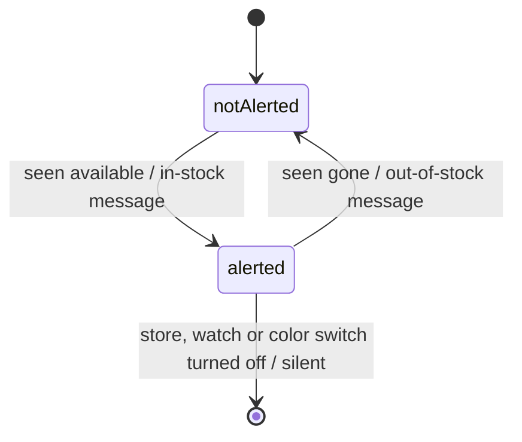

# Overview: Apple Store pickup stock monitor

- Feature: pickup-watch
- Source of truth: docs/features/2026-10-22-pickup-watch/design.md. This page summarises it (and the spec's problem and scope) for review, and adds nothing to them.

## What we're building
New iPhones sell out for in-store pickup, and stock appears at single Apple Stores without warning. A local monitor on the owner's Mac checks the exact configurations they watch at the stores near one zip about once a minute. It sends a Telegram alert, with a buy-page button, when one becomes available and when it goes away. Left out on purpose: login, deploying to Railway, several zips, non-US stores, model-level watches and automated checkout.

## Architecture

One Node process serves the page and the API and runs the monitor loop. Each cycle, the monitor works out which (configuration, store) pairs are tracked. It asks Apple about all of them in one request, using the token pair a browser-side source keeps fresh, and compares the answer with what the owner was last told. It then sends one Telegram message per change. The catalog and the store list come from Apple routes that need no token. launchd restarts the process if it dies.

## Approach and why
We store only "which pairs the owner was told are in stock" and compare each check against it, all in one process with a JSON catalog.
- Observation log instead of the alerted set: lost, because it needs history and pruning no criterion asks for, and failed sends have no natural retry.
- Separate worker process: lost, because a second process gains nothing for one user and one loop.
- Scraping buy-page HTML for the catalog: lost to Apple's token-free locator JSON, which has the same 40 configurations.

## Data model

Watches, stores and the catalog are tables. Each watch is one exact configuration, with an "also other colors" switch. Health ("down" announced or not) and the token are kept in one settings row.

## Key decisions
- Stock already there when you add a watch or start the app alerts right away. You asked for this.
- Tomorrow → Today on a pair already in stock sends nothing. The spec's state is in or out, and the day is only a label.
- A message counts as sent only once Telegram accepts it, so failures retry. Watched in-stock alerts go first.
- The token is warned about 15 minutes before it expires, and "down" goes out at once when it does, instead of after 3 failed checks.
- Every token source posts to one Mac-only route. Automated sources can only replace a pair with a newer one, and a pasted cURL always wins.
- With Wi-Fi access on, any device on the network can use the page, with no key. You chose this, and it fits the spec's no-login v1. The token and the Wi-Fi switch stay Mac-only.
- The CDP spike uses its own Brave profile, because Brave ignores remote debugging on your daily profile.

## Risks
- No automated token source works. The extension is the planned fallback, and the 15-minute warning covers pasted tokens.
- Node's HTTP client may be rejected where curl works. The spike tests this first, and a curl fallback is ready.
- Apple caps the parts per request. The spike sends all 40; a silent cap shows up as a health alert.
- Apple blocks the IP at one request a minute. Health reports it within about 3 minutes, and the interval can be raised.
- Apple changes its JSON. Validation turns this into a health alert, and the stored catalog keeps the picker working.

## Rollout
Local only, for one user on an always-on Mac: fill `.env`, run `npm start`, then install the LaunchAgent. The build order is the token spike first (with a stock alert that covers your Duo before its 10.24 pickup opening), then the core running live on a pasted token, then the token source, then the page.

## Review
The five-seat gulag raised 29 findings and the judge accepted 21. The changes that mattered most:
- a race between edits and the send pass;
- a doubled timer on interval change;
- token writes that a mixed or forged pair could block;
- crash recovery;
- the pre-expiry warning.

The Wi-Fi LAN key the review asked for was dropped at your call.

## Needs your call
- Stale: after the review, you chose open Wi-Fi access over the panel's LAN key. The design now has no key, and the panel hasn't seen that change; you declined a rerun.
- The catalog comes from Apple's locator JSON instead of the buy-page HTML the spec names. It has the same 40 configurations.
