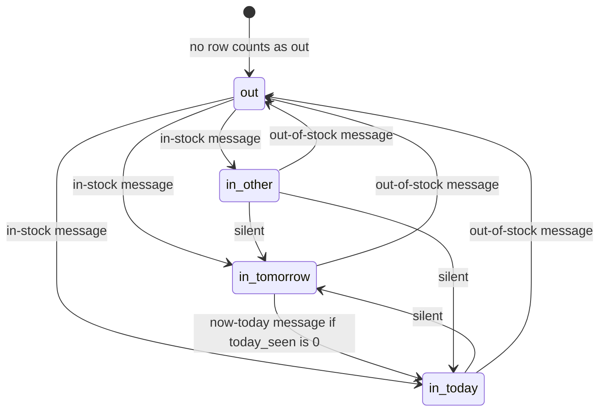
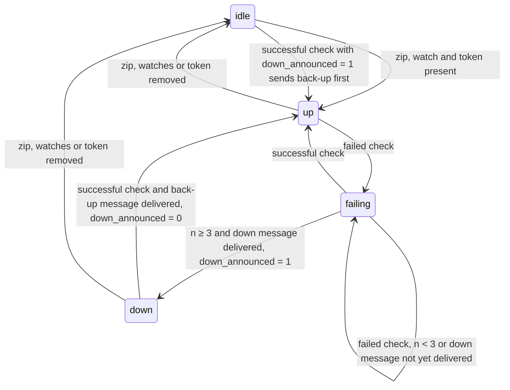
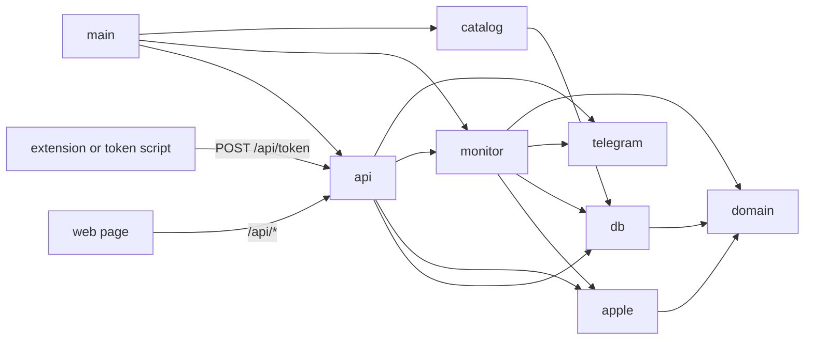

# Design: Apple Store pickup stock monitor

- Feature: pickup-watch
- Spec: docs/features/2026-10-22-pickup-watch/spec.md

## Impact

The repository has no code, configuration, tests or commits yet; every row below is a document or an outside service the new code must respect.

### Impact map

| Area | What | Evidence | Why it matters |
|---|---|---|---|
| Doc | Spec scope | `docs/features/2026-10-22-pickup-watch/spec.md:20-32` | Every module the design adds must trace to one of these lines: catalog, watches, location, other colors, poller, token, stock state, alerts, health, UI, network exposure. |
| Doc | Spec out-of-scope list | `docs/features/2026-10-22-pickup-watch/spec.md:35-43` | Bounds the build: no login, deploy, multi-zip, non-US, model-level watches, checkout automation, autocomplete or sleep handling. |
| Doc | Spec acceptance criteria | `docs/features/2026-10-22-pickup-watch/spec.md:46-64` | Each test seam checks one of these lines; criterion 46 names the "iPhone 18 Pro" page, which also carries the 18 Pro Max. |
| Doc | Spec Facts: deadline, single user, US only, always-on Mac, stack preference, shadcn/ui, local first | `docs/features/2026-10-22-pickup-watch/spec.md:67-77` | The design's constraints and its technology choice rest on these lines. |
| Doc | Spec decision log | `docs/features/2026-10-22-pickup-watch/spec.md:89-108` | Settled input: one request per cycle, other colors in the same request, edge-triggered alerts, Telegram, token source order, localhost default; the stack is decided here with the preference as a constraint. |
| Doc | Persisted state and restart rule | `docs/features/2026-10-22-pickup-watch/spec.md:26`, `docs/features/2026-10-22-pickup-watch/spec.md:54` | The last known (part, store) state must survive a restart so unchanged pairs never re-alert. |
| Doc | Network exposure and secrets | `docs/features/2026-10-22-pickup-watch/spec.md:32`, `docs/features/2026-10-22-pickup-watch/spec.md:62-63` | The server binds to localhost by default, opts into the LAN, and no response may carry the bot token or Apple cookies. |
| External service | Apple `fulfillment-messages`: request and response | `docs/features/2026-10-22-pickup-watch/apple-api-notes.md:9`, `docs/features/2026-10-22-pickup-watch/apple-api-notes.md:21-27` | The poller builds `parts.N` and `location` and parses `stores[].partsAvailability[part].pickupDisplay` and `pickupSearchQuote` into stock state, Today/Tomorrow and the alert fields. |
| External service | Apple token contract with a 2 h hard expiry | `docs/features/2026-10-22-pickup-watch/apple-api-notes.md:16-20` | The client sends the `dssid2` + `shld_bt_ck` pair with a browser User-Agent, classifies 541/HTML as token rejected, and any unattended source must refresh within 2 h. |
| External service | Apple `pickup-message-recommendations` | `docs/features/2026-10-22-pickup-watch/apple-api-notes.md:10` | Returns the 12 nearest stores with no token, so the zip → store list step works before a token exists; unusable for other colors. |
| External service | Apple buy pages: phone variants, product list, URL tokens | `docs/features/2026-10-22-pickup-watch/apple-api-notes.md:12`, `docs/features/2026-10-22-pickup-watch/apple-api-notes.md:29-35` | The catalog keeps the 32 + 8 unlocked phone variants, drops `S…` parts, takes the model from `familyType`, groups other colors by `familyType` + `dimensionCapacity`, and builds links from `seoUrlToken`. |
| External service | Untested Apple behaviour | `docs/features/2026-10-22-pickup-watch/apple-api-notes.md:37-42` | Datacenter IP, automated token, zip in the link and the 60 s block rate are checked in the spike or during implementation, or carried as risks. |
| External service | Telegram Bot API | `docs/features/2026-10-22-pickup-watch/spec.md:27-30`, `docs/features/2026-10-22-pickup-watch/spec.md:59`, `docs/features/2026-10-22-pickup-watch/spec.md:96-97` | Outbound `sendMessage` with an inline URL button for alerts, health and the test message; the bot token and chat id are new configuration no response may return. |

### Checked, not touched
- .git
- docs/features/2026-10-22-pickup-watch/trial-1

## Constraints

Providers:
- Apple's undocumented store endpoints (`fulfillment-messages`, `pickup-message-recommendations`, the two buy pages), authenticated by a `dssid2` + `shld_bt_ck` pair that expires 2 h after issue, whatever its use (`apple-api-notes.md:19`).
- Telegram Bot API for every message; about one message per second per chat, 429 with `retry_after` above that.

Technology preference (spec Facts, a constraint rather than a decision): TypeScript, React and Node; Hono + Vite + React with SQLite in one process; shadcn/ui for the page.

Conventions: none recorded; there is no project `CLAUDE.md` or `.claude/rules/`. `trial-1/` is an archived earlier attempt; this design does not build on it.

Inputs only the owner can supply at setup: the Telegram bot token and chat id, and, if the extension is built, loading it in Brave.

Timeline and outside limits:
- 2026-10-22 to 2026-11-01: a 1-day token spike, then the build.
- Apple may block the session or change its markup at any time; nothing guarantees the endpoints.

## Options considered

The core data shape is the last alerted stock state per (part, store). It decides every message (in-stock, out-of-stock, other color, Tomorrow → Today) and the restart rule; the stack only hosts it.

**A. Last-alerted table, pure diff, commit per message, in one Hono + Vite process with SQLite (recommended).**
- Data: one `availability` row per tracked (part, enabled store) pair holding `out` or `in(day)`. Each check parses Apple's response, a pure `diff` against the rows returns transitions, each transition is sent and its row written as soon as the send succeeds. The grid reads the latest check's observations from memory.
- Structure: 8 flat server files (`domain`, `db`, `apple`, `catalog`, `monitor`, `telegram`, `api`, `main`), one React page with 4 sections, the token source as a separate script or extension.
- Cost: the smallest shape that meets every criterion; one process, one SQLite file, one table to reverse. Matches the recorded preference.
- For the user: one `npm start`; alerts are not repeated on restart; a failed Telegram send is retried on the next check.

**B. Snapshot log, compare the newest two snapshots.**
- Data: a `checks` table with every response's availability (12 stores × N parts a minute); transitions come from comparing the two newest.
- Structure: as A, plus retention and pruning.
- Cost: more storage and a pruning job for a history nothing in the spec asks for.
- For the user: nothing visible beyond A.

**C. Next.js app with a separate worker.**
- Data: as A.
- Structure: Next.js for the page and API routes, plus a long-running worker process for the poll loop, since Next.js request handlers do not run a 60 s loop; on Vercel the loop cannot run at all.
- Cost: two processes and a shared database for one user; outside the recorded preference.
- For the user: the same features with more moving parts to start and to break.

Memory-only state is not an option: it re-alerts every in-stock pair after a restart, which fails `spec.md:54`.

Recommendation: A, because it is the smallest shape that meets the restart criterion, it runs as one process as the spec's one-command start requires, and it is the stack the owner already chose.

## Decisions

1. Stack: Hono + Vite + React + shadcn/ui, SQLite via better-sqlite3, one Node process. Alternatives: Next.js with a worker (C), NestJS, rejected for adding a second process or framework weight to a one-loop app. Principle: principle-smallest-change.
2. Pair state is the tagged value `out | in(day)`, day `today | tomorrow | other`. The last alerted state per tracked (part, enabled store) pair is stored; a pure `diff` returns transitions. Principle: principle-model-the-domain.
3. Transitions that send a message:
   - no row or `out` → `in`: in-stock, labelled watched or other color;
   - `in` → `out`: out-of-stock;
   - `in(tomorrow)` → `in(today)` while the row's `today_seen` is 0: now-today. `today_seen` is set on any `in(today)` observation and reset on `out`, so a pair cycling Today → Tomorrow → Today each day alerts once per in-stock run.
   - Every other change (`in(today)` → `in(tomorrow)`, to or from `other`) updates the row silently.
4. A missing row counts as `out`, so stock already present when a watch is added, a store is re-enabled or the app first starts alerts at once.
5. The tracked set has one definition: the pure `trackedPairs(watches, variants, stores)` in `domain.ts`. After any watch, store or zip change, `db.ts` deletes, in one transaction, only the `availability` rows whose pair left that set, so a part still covered by another watch keeps its rows and "row missing" keeps meaning "not alerted yet".
6. Tracked parts = watched parts ∪ the other colors of watches with `otherColors` on (same model + capacity, different color, from the catalog). A part that is both watched and another watch's other color is labelled watched.
7. One `fulfillment-messages` request per check carries every tracked part. The store list comes only from `pickup-message-recommendations`; stores in a poll response that are not in `stores` are ignored.
8. A tracked pair with no observation in a successful response produces no transition and keeps its row; the grid shows it as "not reported". A whole response with none of the enabled stores is not successful (decision 13).
9. The grid is built from the observations of the latest successful check, held in memory by `monitor.ts`; `availability` stays the last alerted state, so the grid shows Apple's stock even when Telegram fails.
10. Sending and committing:
    - `silent` transitions are written in one transaction before the send pass and never queued.
    - The rest are sorted by priority: watched in-stock (today before tomorrow), watched now-today, other-color in-stock, other-color now-today, out-of-stock; nearest store first within a tier. The sort is pure and sits beside `diff`.
    - Before each send the monitor drops a transition whose pair is no longer in `trackedPairs`.
    - Each transition is sent and committed on its own. The commit is one transaction that re-checks the pair against `trackedPairs` (watch, other-colors flag, enabled store) and writes the row only if it is still tracked. A failed send skips to the next one and leaves the old row, so the next check retries it.
    - Telegram 401, 403, 404 and 400 "chat not found" are setup errors, treated like "not configured": nothing is committed, `TelegramStatus` becomes `failing`, and rows wait for retry. Any other 400 is about that message: it is logged and the row committed, so it is not retried forever. Text falls back to the part number when the variant row is missing.
    - When Telegram is not configured, nothing is sent or committed, so stock alerts once it is configured.
    - Delivery is at-least-once: a timeout after Telegram delivered, or a crash between send and write, can repeat one message.
11. Poll loop: a `setTimeout` chain that reads the interval before each wait; default 60 s, jitter ±25 % of the interval, every wait at least 30 s (45–75 s at the default), so an interval change applies at the next wait. A single-flight guard keeps a check from starting while the previous send pass runs; the send pass stops when the next check is due and leaves the rest uncommitted for that check. Every Apple request has `AbortSignal.timeout(20_000)` and every Telegram call `AbortSignal.timeout(10_000)`, so a hung call cannot hold the guard or the queue.
12. A check runs only when a zip, at least one tracked part and a token exist; otherwise health is `idle` with the reason shown in the UI and nothing is sent.
13. Health:
    - `up` → `failing(n)` on a failed check; at n ≥ 3 the down message is sent, and `down` is entered only after it is delivered, retrying on each failed check meanwhile.
    - Delivery of the down message sets `config.down_announced` to 1; delivery of the back-up message clears it. On any successful check with the flag set, the back-up message is sent whatever the in-memory state, so a restart or a trip through `idle` while down still ends with "back up".
    - Failure kinds: `token-rejected` (HTTP 541 or an HTML body), `network` (fetch error or the 20 s timeout), `unexpected` (a 200 that fails the schema or contains none of the enabled stores).
14. Apple responses, buy-page JSON and every request body are parsed once with zod at the boundary; nothing past `apple.ts`, `catalog.ts` and `api.ts` reads raw shapes. Apple URLs are built only with `URLSearchParams`. Principle: principle-model-the-domain.
15. Catalog: both buy pages are scraped at startup and every 24 h, and every 5 minutes after a scrape that throws or yields zero variants, until one succeeds. Only variant objects with a `familyType` in `MODELS` and a `seoUrlToken` ending in `-unlocked` are kept, which drops the `S…` parts. The scrape is an upsert in one transaction that never deletes a row. Principle: principle-smallest-change.
16. Token:
    - One row (`dssid2`, `shld_bt_ck`, `userAgent`, `source`, `updatedAt`, `expiresAt` from the `shld_bt_ck` timestamp), written only through `setToken` in `db.ts`.
    - Every source reaches it through `POST /api/token`: the pasted cURL, and whichever the spike picks, a standalone Playwright script or the browser extension, both separate processes never imported by `main.ts`.
    - `POST /api/token` answers 400 and keeps the current row when either cookie is missing, when `expiresAt` cannot be parsed or is in the past, or when `expiresAt` is not later than the stored token's, unless the stored status is `rejected`.
    - An automated source refreshes before `expiresAt`, since the pair expires 2 h after issue whatever its use.
    - Playwright or CDP sources use a dedicated profile used only for apple.com, never the owner's daily Brave profile; the debugging port binds to `127.0.0.1` without a wildcard `--remote-allow-origins`. If only the daily profile works, the extension is built instead.
    - The cURL parser keeps only the two cookies and the User-Agent and discards the rest without logging. `Set-Cookie` from Apple is ignored unless the spike shows adopting the new `dssid2` helps.
    - The settings strip shows token status `missing | ok | rejected | expiring` and the time left before `expiresAt`.
17. Telegram: `TELEGRAM_BOT_TOKEN` and `TELEGRAM_CHAT_ID` in `.env`, with chat-id setup in the README; the UI shows configured yes/no and `ok | failing` from the last send. One sequential queue for alerts, health and the test message, at least 1 s apart, honouring `retry_after`. Logs carry only the HTTP status, Telegram's `error_code` and `description` and the message kind, never the URL (which holds the bot token), the request object or the raw error; `apple.ts` likewise never logs the Cookie header.
18. Request guard in `api.ts`:
    - Every request, GET included, must carry a `Host` on an explicit allowlist (`localhost:PORT`, `127.0.0.1:PORT`, and with Wi-Fi on the Mac's interface IPs and `<hostname>.local:PORT`), else 421; this blocks DNS rebinding.
    - Mutations need `Content-Type: application/json` and an `Origin` on the same allowlist; a request with no `Origin` passes only from loopback. In development only, the Vite dev Origin is added to the allowlist.
    - Loopback is decided only from the socket's remote address (`127.0.0.1`, `::1`, `::ffff:127.0.0.1`, via Hono `getConnInfo`), never from `Host` or `X-Forwarded-For`.
    - `POST /api/token` requires loopback AND (no `Origin`, or the pinned `chrome-extension://<id>` origin). `PUT /api/config { lanEnabled }` requires loopback. The extension id is pinned by a fixed `key` in the manifest.
    - Bodies and path parameters: `zip` `^\d{5}$`; `intervalSec` integer 30–3600; `parts` at most 20 known parts; `:part` on `PATCH`/`DELETE /api/watches` a known part; `storeNumber` a known store; `lanEnabled` boolean; `dssid2` and `shldBtCk` printable ASCII without `;`, `,`, whitespace or CR/LF, length-capped, `shldBtCk` matching `<id>|<digits>|<payload>|<sig>`; `userAgent` printable ASCII up to 512 characters; `source` the enum.
    - Errors are fixed DTOs (`{ error: '<code>' }`) from every route and `onError`; responses are explicit DTOs without secret fields.
    - In-memory limits: one test message and one zip change per 10 s, else 429.
19. Wi-Fi access is the persisted `lanEnabled` setting read at boot: listen on `127.0.0.1`, or `0.0.0.0` when on; after a change the strip shows "restart to apply". With Wi-Fi on and no access key, any device on the LAN can read and change watches, stores, zip and interval by forging `Host` and `Origin`; only `POST /api/token` and `lanEnabled` stay loopback-only. The owner accepted this with no access key (user, 2026-10-22).
20. `PUT /api/config { zip }` fetches the store list first, using a fixed known part from `MODELS` as the recommendations `product` so it works before the first scrape. On failure or zero stores it answers 4xx and changes nothing. Otherwise, in one transaction, it writes the zip, keeps the `enabled` value of every store present in both the old and new lists, enables only stores new to the list, and clears the rows no longer tracked.
21. The UI polls `GET /api/state` every 10 s; no websocket or server-sent events. Principle: principle-smallest-change.
22. The grid is one card per watch with store status badges at every width, since 12 store columns cannot fit 375 px. Principle: principle-smallest-change.
23. The alert link is `https://www.apple.com/shop/buy-iphone/<page>/<seoUrlToken>`; a zip is added only if a check during implementation shows the page accepts one.
24. Test fixtures hold only fake values for `dssid2` and `shld_bt_ck`; every other Cookie and Set-Cookie value is removed before saving, and `apple.test.ts` fails if a fixture contains any other cookie name. `spike/RESULT.md` records lifetimes and outcomes, never token values.

## Data shapes

```ts
// domain.ts
type Model = 'iphone18pro' | 'iphone18promax' | 'iphoneduo'          // Apple familyType
const MODELS: Record<Model, { label: string; buyPage: 'iphone-18-pro' | 'iphone-duo'; lookupPart: string }>

type Variant = {
  part: string            // 'MJW44LL/A'
  model: Model
  capacity: string        // '256gb'
  color: string           // 'black'
  name: string            // 'iPhone 18 Pro Max 256GB Black'
  price: number
  url: string             // https://www.apple.com/shop/buy-iphone/iphone-18-pro/6.9-inch-display-256gb-black-unlocked
}

type Watch = { part: string; otherColors: boolean }
type Store = { storeNumber: string; name: string; city: string; state: string; distanceMi: number; enabled: boolean }

type Day = 'today' | 'tomorrow' | 'other'
type PairState = { kind: 'out' } | { kind: 'in'; day: Day; quote: string }
// pickupDisplay 'available' → in; anything else ('unavailable', 'default', unknown) → out
// day from pickupSearchQuote: /today/i → today, /tomorrow/i → tomorrow, else other

type Role = { kind: 'watched' } | { kind: 'other-color'; watchedPart: string }
type TrackedPair = { part: string; storeNumber: string; role: Role }
declare function trackedPairs(watches: Watch[], variants: Variant[], stores: Store[]): TrackedPair[]   // pure, the single definition

type Observation = { part: string; storeNumber: string; state: PairState }
type Transition =
  | { kind: 'in-stock'; part: string; storeNumber: string; day: Day; quote: string; role: Role }
  | { kind: 'out-of-stock'; part: string; storeNumber: string; role: Role }
  | { kind: 'now-today'; part: string; storeNumber: string; role: Role }
  | { kind: 'silent'; part: string; storeNumber: string; state: PairState }

type FailureKind = 'token-rejected' | 'network' | 'unexpected'
type IdleReason = 'no zip' | 'no watches' | 'no token'
type Health =
  | { kind: 'idle'; reason: IdleReason; lastSuccessAt: string | null }
  | { kind: 'up'; lastSuccessAt: string | null }
  | { kind: 'failing'; count: number; lastFailure: FailureKind; lastSuccessAt: string | null }
  | { kind: 'down'; since: string; lastFailure: FailureKind; lastSuccessAt: string | null }

type Token = { dssid2: string; shldBtCk: string; userAgent: string; source: 'paste' | 'extension' | 'playwright'; updatedAt: string; expiresAt: string }
type TokenStatus = 'missing' | 'ok' | 'rejected' | 'expiring'   // the only token data the API returns, with minutes left
type TelegramStatus = 'ok' | 'failing'
```

Pair state per (part, store):



Health (`down_announced` persisted, the rest in memory):



SQLite tables, created on boot with `CREATE TABLE IF NOT EXISTS`:

| Table | Columns | Notes |
|---|---|---|
| `variants` | `part` PK, `model`, `capacity`, `color`, `name`, `price`, `url`, `updated_at` | Upserted by each scrape; no row is ever deleted. |
| `watches` | `part` PK → `variants.part`, `other_colors` 0/1 default 1, `created_at` | |
| `stores` | `store_number` PK, `name`, `city`, `state`, `distance_mi`, `enabled` 0/1 default 1 | Rewritten on zip change, keeping `enabled` for stores in both lists. |
| `availability` | (`part`, `store_number`) PK, `state` `out`/`in`, `day` `today`/`tomorrow`/`other` or NULL, `quote`, `today_seen` 0/1, `changed_at` | Last alerted state; tracked pairs only. |
| `config` | single row: `zip` NULL, `interval_sec` default 60, `lan_enabled` 0/1 default 0, `down_announced` 0/1 default 0 | |
| `token` | single row: `dssid2`, `shld_bt_ck`, `user_agent`, `source`, `updated_at`, `expires_at` | Never serialised by the API. |

## Module boundaries



- `domain.ts`: types, the `MODELS` registry and the pure `trackedPairs`, the single definition of the tracked set; imports nothing.
- `db.ts`: opens SQLite, creates tables, typed reads and writes per table, `setToken` as the only token write, and the row-clearing transaction (by `trackedPairs`) that the watch, store and zip routes call. The only module with SQL.
- `apple.ts`: `fulfillment-messages` and `pickup-message-recommendations` requests with the token pair and timeouts, failure classification, zod parsing into `Observation[]` and `Store[]`, cURL parsing into a `Token`. The only module that knows Apple's request and response shapes.
- `catalog.ts`: fetches both buy pages and returns `Variant[]`; scheduled by `main.ts`.
- `monitor.ts`: poll loop and single-flight guard, pure `diff` and priority sort, health machine, latest observations, commit per message using `trackedPairs` for the check and the commit.
- `telegram.ts`: message text and URL button, the sequential queue with timeouts, `TelegramStatus`, redacted logging. The only module that reads `TELEGRAM_*`.
- `api.ts`: Hono routes, Host/Origin/loopback guard, zod bodies, DTOs, fixed errors, rate limits.
- `main.ts`: loads `.env`, opens the db, starts the catalog schedule and the monitor, serves the built page and `api`, listens on the host from `config.lan_enabled`.
- `web/`: the React page; calls only `/api/*`.
- Token sources (`scripts/token-playwright.ts` or `extension/`): separate processes that only call `POST /api/token`.

API:

| Route | Body / result |
|---|---|
| `GET /api/state` | `{ config, stores, watches, observations, lastCheckAt, health, tokenStatus, tokenMinutesLeft, telegramConfigured, telegramStatus }` |
| `GET /api/catalog` | variants grouped by model → capacity → color |
| `PUT /api/config` | `{ zip?, intervalSec?, lanEnabled? }`; zip per decision 20; `lanEnabled` loopback only, applied on restart |
| `POST /api/watches` | `{ parts: string[] }` |
| `PATCH /api/watches/:part` | `{ otherColors: boolean }` |
| `DELETE /api/watches/:part` | removes the watch and the rows no longer tracked |
| `PATCH /api/stores/:storeNumber` | `{ enabled: boolean }` |
| `POST /api/token` | `{ curl }` or `{ dssid2, shldBtCk, userAgent, source }`; loopback AND (no Origin or the pinned extension Origin); 400 keeps the current row for a missing cookie or a stale or unparseable `expiresAt` |
| `POST /api/telegram/test` | queues a test message; one per 10 s |

## File map

```
pickup-watch/
├── package.json            scripts: dev (vite + server), start (build page, run server), test (vitest), spike, seed
├── tsconfig.json           strict TypeScript for server and web
├── vite.config.ts          React build to dist/; dev server.host '127.0.0.1', default allowedHosts, /api proxy without changeOrigin
├── components.json         shadcn/ui config
├── index.html              Vite entry
├── .env.example            TELEGRAM_BOT_TOKEN, TELEGRAM_CHAT_ID, PORT
├── .gitignore              node_modules, dist, .env, *.db, spike/profiles/
├── README.md               setup: bot and chat id, start, pasting a cURL, Wi-Fi access, token source, checkout from the phone on cellular if the Mac's network is blocked
├── server/
│   ├── main.ts             boot, catalog schedule, monitor start, listen
│   ├── domain.ts           types, MODELS registry, trackedPairs
│   ├── db.ts               schema, typed queries, setToken, row-clearing transaction
│   ├── apple.ts            Apple requests with timeouts, failure kinds, zod parsing, cURL parsing
│   ├── catalog.ts          buy-page scrape → Variant[]
│   ├── monitor.ts          poll loop, single-flight, diff, priority sort, health, commit per message
│   ├── telegram.ts         message text, sequential queue, status, redacted logs
│   └── api.ts              routes, Host/Origin/loopback guard, zod bodies, DTOs, rate limits
├── web/
│   ├── main.tsx            React root
│   ├── App.tsx             layout and 10 s state polling
│   ├── api.ts              typed fetch helpers
│   ├── sections/
│   │   ├── LocationSection.tsx   zip input, store toggles
│   │   ├── WatchPicker.tsx       Model → Storage → Color multi-select, other-colors switch
│   │   ├── WatchGrid.tsx         card per watch with store badges, last check time
│   │   └── SettingsStrip.tsx     Telegram status and test, token status, time left and cURL paste, interval, Wi-Fi, idle reason
│   └── components/ui/      shadcn/ui generated components
├── test/
│   ├── fixtures/           captured on day 1, sanitised: fulfillment 200 (multi-part, every pickupDisplay, Today and Tomorrow quotes), 541 HTML, recommendations 200, trimmed buy pages, sample cURL with fake cookies
│   ├── apple.test.ts       parsing, failure kinds, cURL parsing, expiresAt, fixture cookie check
│   ├── catalog.test.ts     variant filter, grouping, upsert never deletes
│   ├── monitor.test.ts     diff, sort, trackedPairs, health, idle, down_announced, commit per message, single-flight, jitter, timeouts
│   ├── telegram.test.ts    text and button, spacing, retry_after, setup vs message 4xx, redacted logs
│   └── api.test.ts         no secrets in any response, guard, body and token validation, zip change, limits
├── spike/
│   ├── token.ts            Playwright and dedicated-profile CDP variants, pasted-pair replay through apple.ts's request function, tab-reload check
│   └── RESULT.md           each variant's outcome and lifetime, Node client accepted yes/no, Set-Cookie test, parts cap, chosen source, deploy implication
├── scripts/                one of scripts/ or extension/ is added, chosen by the spike
│   ├── seed.ts             writes zip, stores, watches and a pasted token straight to SQLite before the page exists
│   └── token-playwright.ts if Playwright wins: spike/token.ts's winning variant promoted to a standalone process posting to POST /api/token
└── extension/              if the extension wins
    ├── manifest.json       MV3, fixed key, cookies and alarms, host_permissions https://www.apple.com/* and http://127.0.0.1:<PORT>/*
    └── background.js       on an alarm before expiry: open or reload an apple.com tab, chrome.cookies.get for dssid2 and shld_bt_ck only, post to 127.0.0.1, retry a failed post on each alarm until it succeeds
```

## Test seams

| Criterion | Where | What the test controls |
|---|---|---|
| `spec.md:46` picker lists every configuration | `catalog.test.ts` | Trimmed buy-page fixtures: 32 + 8 phones kept, `S…` parts dropped, model from `familyType`, grouping; the upsert never deletes a row |
| `spec.md:47` zip lists stores, all on; a disabled store never alerts | `api.test.ts`, `monitor.test.ts` | Recommendations fixture via a fake fetch; a failed or empty lookup changes nothing; re-saving a zip keeps disabled stores disabled; `diff` with a disabled store |
| `spec.md:48` one request with all tracked parts; 45–75 s apart | `monitor.test.ts` | Fake fetch counts calls and reads `parts.N`; injected random and clock; a slow fake Telegram across two ticks sends each transition once; a fetch that never resolves times out and the next check still runs |
| `spec.md:49-50` other-colors switch and labelled messages | `monitor.test.ts`, `telegram.test.ts` | Catalog with sibling colors; `role: other-color`; text contains "Other color"; deleting one watch keeps rows another still covers |
| `spec.md:51` interval change without restart | `monitor.test.ts` | Config changed between waits on a fake clock |
| `spec.md:52-54` in, out, no repeat, restart | `monitor.test.ts` | Observation sequences against stored rows; a fresh monitor on the same SQLite file sends nothing for unchanged pairs; a watch deleted during the send leaves no row; a missing part gives no transition; priority order; `today_seen` stops a daily now-today |
| `spec.md:55` `unavailable` and `default` are out | `apple.test.ts` | Fixture with all three values |
| `spec.md:56` down and back up | `monitor.test.ts` | Fake fetch: 541, a throw, malformed JSON, a 200 with no enabled store, three times, then 200; a failing down message is retried; a restart with `down_announced` set sends back-up on the first success; no zip, watch or token gives `idle` and no message |
| `spec.md:57` token status and cURL paste | `apple.test.ts`, `api.test.ts` | cURL with `-b` and with `-H 'cookie:'`; only three values kept; `expiresAt` from the cookie timestamp; a missing cookie, a past or older `expiresAt` get 400 and keep the row |
| `spec.md:58` spike result; extension keeps the token valid | Manual | `spike/RESULT.md`; with the extension loaded, token status stays `ok` across a 2 h expiry |
| `spec.md:59` test message | Manual with the real bot; `telegram.test.ts` | Fake fetch for request shape; a 401 leaves rows unwritten and status `failing`; a message-specific 400 on message 1 of 3 commits it and sends the rest; a forced 400 and network error log no bot token |
| `spec.md:60` grid shows state and last check | Manual | A running monitor |
| `spec.md:61` 375 px | Manual | Browser device mode |
| `spec.md:62` localhost by default, Wi-Fi opt-in | Manual from the phone; unit test of the chosen host | — |
| `spec.md:63` no secrets in responses | `api.test.ts`, `apple.test.ts` | Seeded fake bot token and cookies; no GET, POST, PUT, PATCH or DELETE response contains them, including forced Telegram and cURL-parse failures; fixtures contain no other cookie names |
| Request guard (decision 18) | `api.test.ts` | Host `attacker.example` gets 421 on GET and PUT; non-loopback mutation without Origin gets 403; a non-loopback `POST /api/token` with the pinned extension Origin gets 403; a different extension origin is rejected; `intervalSec` 1, an unknown part and a malformed cookie get 400 |
| `spec.md:64` one start command | Manual | `npm start` on a clean clone |

## Risks

- **Node's HTTP client is rejected where curl and the browser were accepted** (unknown): the spike replays the pair through `apple.ts`'s request function with a curl control. If Node is rejected, the extension performs the `fulfillment-messages` fetch in-page and posts observations instead of cookies.
- **No automated token source works** (medium): the extension is the planned route; until it exists, a pasted pair lasts at most 2 h and the strip shows the time left; the health alert names `token-rejected`.
- **In paste-only mode the owner gets no warning before the 2 h expiry** (medium until a token source exists): they learn of it only from the down alert about 3 minutes later.
- **An extension-reloaded tab does not get a fresh pair** (unknown): the spike's tab-reload check records whether the `shld_bt_ck` timestamp moves forward; if not, pasting every 2 h is the only source, and `spike/RESULT.md` says so.
- **Apple blocks the session or IP at a 60 s rate** (medium): the health alert reports it within about 3 minutes and the interval is adjustable with a 30 s floor. A block may also refuse the owner's own checkout from the same IP or session; the README tells the owner to check out from the phone on cellular after an alert if the Mac's network is blocked.
- **Apple caps parts per request** (unknown; 3 tested): the spike measures it with all 40 phone parts; a cap below the tracked count breaks the one-request criterion and goes back to the owner.
- **Apple drops or renames a `MODELS.lookupPart`** (low): zip changes return 4xx until the constant is edited.
- **Apple changes markup** (low per week, high over months): parsing fails into `unexpected`, reported by the health alert; the stored catalog keeps the picker working.
- **A burst of messages hits Telegram's limit** (medium on first start): sequential queue, priority order, commit per message, single-flight.
- **Wi-Fi access without login** (opt-in, home network): any LAN device can read and change watches, stores, zip and interval by forging `Host` and `Origin`; the token and the Wi-Fi switch stay loopback-only.
- **The later deploy needs a token source off the Mac** (high if deployed): only the extension or a residential-IP script posting to `POST /api/token` would serve Railway; `spike/RESULT.md` records it.
- **Apple's terms limit automated access** (unknown consequence): no Apple ID is used, one request a minute, personal use.

## Rollout

Single user on their own Mac (`spec.md`, Facts), so no staged release, flag or migration: the owner fills `.env` and runs `npm start`.

Order of work against the 2026-11-01 deadline (`spec.md`, Facts), building the riskiest piece early and keeping a live monitor running as soon as one exists:
1. Day 1, token spike:
   - capture sanitised fixtures with a fresh pasted pair (decision 24);
   - replay the pair at 60 s ±15 s to its expiry through the request function `apple.ts` will use (Node fetch, stored User-Agent, same headers), with one curl replay of the same pair as a control, and record "HTTP client accepted: yes/no";
   - test adopting `Set-Cookie`;
   - measure the parts-per-request cap with all 40 phone parts;
   - reload an apple.com tab in normal Brave and record whether the `shld_bt_ck` timestamp moves forward and whether the new pair returns 200;
   - try the Playwright and dedicated-profile CDP variants;
   - write `spike/RESULT.md`.
2. Core modules with their tests, then run live on a pasted cURL against the real watches, configured with `scripts/seed.ts`, and keep it running from then on.
3. The token source the spike chose, including the 2 h expiry check of `spec.md:58`.
4. API and the page.
5. A sustained live run against real stock, the spec's success measure.

## Facts
- The alerts must be working by 2026-11-01 (spec.md)
- The monitor has a single user, the owner (spec.md)
- Only US Apple Stores are watched (spec.md)
- The Mac running the monitor is always on and does not sleep (spec.md)
- The user prefers TypeScript, React and Node, and agreed to Hono + Vite + React with SQLite in one process (spec.md)
- The user wants the UI built with shadcn/ui (spec.md)
- The app runs locally for now; a later deploy may target Railway (spec.md)
- The Apple token pair expires 2 h after issue and replaying it does not extend it (docs/features/2026-10-22-pickup-watch/apple-api-notes.md:19)
- Stock already present when a watch is added, a store is re-enabled or the app starts should alert right away (user, 2026-10-22)
- Tomorrow to Today should send a message, only the first time per in-stock run (user, 2026-10-22)
- If only the daily Brave profile works over CDP, the extension is built instead (user, 2026-10-22)
- The extension is built whenever no automated source works, as the spec says (user, 2026-10-22)
- Pasting a cURL only needs to work from the Mac (user, 2026-10-22)
- Wi-Fi access needs no access key in v1, knowing any device on the network can then change watches, stores, zip and interval (user, 2026-10-22)

## Assumptions
None

## Open questions
None

## Gulag outcome

**Panel:** workflow fbs:panel. Seats: pessimist, security, lazy-boi, code-purist, staff-engineer; none missing.

- pessimist-1 (major): accepted, a wrong bot token or chat id on day one would mark every in-stock pair as alerted; setup errors are reclassified.
- pessimist-2 (major): accepted, `POST /api/token` wrote any pair unchecked, and partial or mismatched pairs return 541.
- pessimist-3 (major): accepted, narrowed: a 200 with no enabled store is `unexpected`, while one missing part does not fail the check; the parts cap is measured with all 40 parts.
- pessimist-4 (major): accepted, no timeout values meant a hung fetch could hold the single-flight guard forever.
- pessimist-5 (major): accepted, the extension route was said to be tested in the spike but no spike step tested it.
- pessimist-6 (minor): accepted, the tracking check ran before the send but the row was written after it.
- pessimist-7 (minor): accepted, in-memory health could send "down" and never "back up" across a restart or idle.
- pessimist-8 (minor): accepted, re-saving a zip re-enabled stores the owner had turned off.
- pessimist-9 (minor): rejected, a dropped lookup part within 10 days is speculative and the failure is visible and fixed by one constant; kept as a risk.
- pessimist-10 (minor): accepted, the priority list left out other-color now-today and silent updates.
- security-1 (major): accepted, a LAN device can forge Host and Origin and change everything, not only read; the no-key decision goes back to the owner.
- security-2 (major): accepted, the pinned extension Origin is forgeable from the LAN; token posts now require loopback by socket address.
- security-3 (major): accepted, fixtures from the live session could carry every apple.com cookie into the repo.
- security-4 (minor): accepted, the bot token sits in every Telegram URL and failures were logged.
- security-5 (minor): accepted, token body fields go into outbound headers without validation, and `:part` was unvalidated.
- security-6 (minor): accepted, the extension's cookie permission in the daily profile was not limited to the two cookies.
- security-7 (minor): accepted, the dev proxy makes every request loopback unless its settings are stated.
- lazy-boi-1 (major): rejected, a first-start burst in diff order can push a watched alert past one cycle and an unbounded send pass breaks the 45–75 s spacing.
- lazy-boi-2 (minor): accepted, once the upsert never deletes, the scrape thresholds protect nothing; the 5-minute retry stays.
- lazy-boi-3 (minor): rejected, without delivery gating a down message lost to a network or 5xx error would never arrive.
- code-purist-1 (minor): accepted, no owner was named for the tracked-set recompute that api.ts and monitor.ts both need.
- code-purist-2 (minor): rejected, taste; cURL parsing extracts Apple's cookie pair and fits apple.ts.
- code-purist-3 (minor): accepted, the tree omitted scripts/ and extension/ and their relation to spike/token.ts.
- staff-engineer-1 (major): accepted, the token source was built after the API and page, close to the deadline.
- staff-engineer-2 (major): accepted, the pair was only ever replayed from a browser or curl, never from Node.
- staff-engineer-3 (minor): rejected, the down alert already names token-rejected about 3 minutes after expiry; kept as a risk.
- staff-engineer-4 (minor): accepted, narrowed to a risk note and a README line: a block may also refuse the owner's own checkout.

Changes applied: decisions 5, 8, 10, 11, 13, 15, 16, 17, 18, 19 and 20 revised and decision 24 added; `trackedPairs`, `down_announced` and the health diagram's down → idle edge added to the data shapes; `stores` and `variants` notes, API table, module boundaries, file map (vite settings, .gitignore, README, scripts/, extension/, seed script), test seams, risks and rollout updated; "Wi-Fi access needs no access key in v1" moved from Facts to Open questions.

## Decision log
- 2026-10-22: Hono + Vite + React + shadcn/ui with SQLite in one process, over Next.js with a separate worker or NestJS. Why: the core is one long-running loop for one user; a second process or heavier framework adds nothing a criterion needs, and it is the owner's recorded preference. Principle: principle-smallest-change
- 2026-10-22: Store the last alerted state per tracked pair and diff against it, over a snapshot log or memory-only state. Why: smallest shape that meets the restart criterion; a log adds pruning for an unused history, and memory re-alerts after a restart. Principle: principle-smallest-change
- 2026-10-22: Pair state is `out | in(day)` and transitions a tagged union. Why: one structure decides every message kind instead of booleans spread across files. Principle: principle-model-the-domain
- 2026-10-22: A missing row counts as `out`. Why: the owner wants to hear about stock already there (user, 2026-10-22).
- 2026-10-22: Now-today fires once per in-stock run via `today_seen`; other day changes are silent. Why: the owner wants to know same-day pickup opened, not a daily repeat (user, 2026-10-22).
- 2026-10-22: One pure `trackedPairs` in `domain.ts` defines the tracked set for the check, the commit and row clearing. Why: three callers need the same rule, and one definition keeps them from drifting. Principle: principle-model-the-domain
- 2026-10-22: Silent updates first in one transaction; sends in priority order; commit per message in a transaction that re-checks tracking; setup 4xx errors commit nothing. Why: a stale check or a misconfigured bot cannot mark stock as alerted, one bad message cannot block the rest, and failed sends retry without an outbox.
- 2026-10-22: Grid from the latest observations in memory, `availability` as last alerted. Why: the grid must show stock when Telegram fails or is not configured.
- 2026-10-22: Single-flight checks, a send pass bounded by the next check, fixed 20 s Apple and 10 s Telegram timeouts. Why: keeps 45–75 s spacing without double-sends, and a hung call cannot freeze the monitor.
- 2026-10-22: Idle health state, delivery-gated down/up, and a persisted `down_announced` flag. Why: setup must not send a false down message, a lost down message must be retried, and every down must end with a back-up message even across a restart.
- 2026-10-22: Store list only from `pickup-message-recommendations`, validated before any write, keeping existing store toggles. Why: it needs no token, a failed lookup leaves the old setup intact, and re-saving a zip must not re-enable excluded stores.
- 2026-10-22: zod at every boundary, including token fields and path parameters; Apple URLs via `URLSearchParams`. Why: markup changes become one `unexpected` failure, and bad input never reaches the db, Apple or outbound headers. Principle: principle-model-the-domain
- 2026-10-22: Catalog at startup, every 24 h and every 5 min after a failed or empty scrape, as an upsert that never deletes. Why: the picker and links survive failed scrapes, and with no deletes no threshold is needed. Principle: principle-smallest-change
- 2026-10-22: All token sources go through `POST /api/token`, which rejects partial, expired or older pairs; automated sources are separate processes with a dedicated profile and refresh before `expiresAt`. Why: the pair expires 2 h after issue, a bad post must not replace a working token, the server stays able to run on Railway, and the daily profile is never exposed on a debugging port (user, 2026-10-22).
- 2026-10-22: Telegram credentials in `.env`, logs redacted to status, code and description. Why: one user, no extra path that handles a secret, and the bot token sits in every request URL.
- 2026-10-22: Host allowlist on every request, Origin rules on mutations, loopback by socket address for token and Wi-Fi changes, fixed error DTOs, rate limits, dev proxy pinned to 127.0.0.1. Why: there is no login, DNS rebinding reaches localhost, Origin is forgeable from the LAN, and these close it at little cost.
- 2026-10-22: No access key for Wi-Fi access in v1. Why: the owner accepted that any LAN device can change watches, stores, zip and interval while Wi-Fi access is on; login is out of the spec's scope, and the token and Wi-Fi switch stay Mac-only (user, 2026-10-22).
- 2026-10-22: `lanEnabled` read at boot with "restart to apply". Why: no criterion needs a live switch, and re-listening can leave the server bound to nothing. Principle: principle-smallest-change
- 2026-10-22: Interval 30–3600 s with ±25 % jitter, waits of at least 30 s. Why: keeps 45–75 s at the default and prevents back-to-back checks.
- 2026-10-22: 10 s UI polling, over websockets or server-sent events. Why: checks run once a minute. Principle: principle-smallest-change
- 2026-10-22: One card-per-watch layout at every width. Why: 12 store columns cannot fit 375 px and a second layout serves no criterion. Principle: principle-smallest-change
- 2026-10-22: 8 flat server files, over a folder per module. Why: one owner role per file and one caller per function. Principle: principle-smallest-change
- 2026-10-22: Sanitised fixtures with fake cookie values and a test that rejects any other cookie name. Why: fixtures captured from the owner's live session would otherwise commit their apple.com cookies.
- 2026-10-22: Rollout builds the token spike and core first, runs live on a pasted cURL via a seed script, then the token source, then the API and page. Why: the token is the existential risk, and an early live monitor can catch a stock event during the build.
- 2026-10-22: Rejected pessimist-9: a fixed `lookupPart` per model breaks zip changes if Apple drops it. Why: not worth it at this stage; dropping a current-generation part within 10 days is speculative, and the failure is visible and fixed by one constant.
- 2026-10-22: Rejected lazy-boi-1: drop the priority sort and the bounded send pass. Why: a first-start burst in diff order can push a watched alert past one cycle (spec.md:52), and an unbounded send pass under single-flight breaks the 45–75 s spacing (spec.md:48). Principle: principle-smallest-change
- 2026-10-22: Rejected lazy-boi-3: delivery-gated down/up adds a retry machine the spec does not need. Why: the queue retries only 429, so a down message lost to a network or 5xx error would never arrive and spec.md:56 would go unmet. Principle: principle-smallest-change
- 2026-10-22: Rejected code-purist-2: move cURL parsing out of apple.ts and diff into its own file. Why: taste; cURL parsing extracts Apple's cookie pair, and the pure diff is already testable as an export of monitor.ts.
- 2026-10-22: Rejected staff-engineer-3: send a warning before the token's `expiresAt`. Why: not worth it at this stage; the down alert names token-rejected about 3 minutes after expiry and the strip shows the time left, so the warning gains about 18 minutes of notice at the cost of a new message kind.
